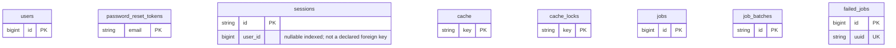

# Database Architecture and Phase 2 Schema Proposal

> **Status: APPROVED — ZERO-TABLE CORE SCHEMA.** The approved Phase 2 schema contains no Core-owned tables. Foundation currently requires no Core-owned database tables. This approval does not authorize speculative tables or changes to Laravel stock schema.

## Proposal summary

The approved Phase 2 Core schema contains **no Core-owned tables**. Foundation currently requires no Core-owned database tables: Phase 1 provides package configuration and a health endpoint that performs no database work. The approved global UI/CRUD standards define interaction and code-comment behavior; they do not establish persisted Core domain entities. This Phase 2 approval does not prevent a later module from receiving a separate, explicitly approved migration proposal.

The Foundation package already registers `packages/core/foundation/database/migrations`, but it currently contains no package migration. The host Laravel app has its stock user, cache, and queue migrations and the stock `App\\Models\\User`. Keep those host-owned assets unchanged.

## 1. Phase 2 required tables

**None proposed.** There is no currently approved Core feature that requires persistent state. The health API reads package configuration and must remain database-independent. Therefore there are no Phase 2 Core columns, keys, constraints, indexes, timestamps, soft-delete rules, or Core relationships to implement.

### Data dictionary

| Core table | Purpose | Columns and types | Keys, constraints, and indexes | Nullable fields | Timestamps | Soft deletes | Relationships |
|---|---|---|---|---|---|---|---|
| None | No persisted Core entity is justified by the approved Phase 1/Phase 2 scope. | Not applicable | Not applicable | Not applicable | Not applicable | Not applicable | None |

## 2. Module-owned database responsibilities after Phase 2

**None were part of the approved Phase 2 schema.** Later phases have separately implemented or retained these responsibilities; they remain outside Foundation:

- **Authentication (Phase 4):** uses the Laravel host's existing `users`, `password_reset_tokens`, and `sessions` tables; it owns no authentication table.
- **User Management (Phase 5):** adds account lifecycle columns to the host's existing user table through the separately approved package migration described below. No Core users table is allowed.
- **Settings (Phase 3):** owns the `master_core_settings` table through its separate package migration.
- **Audit Logs (Phase 7):** owns one `master_core_audit_events` table through its separate package migration. This later module-owned table does not alter the approved Phase 2 zero-table Foundation schema.
- **Notifications (Phase 10):** owns one `master_core_notifications` table for recipient-scoped in-app notices and read state. The polymorphic host-user recipient has no foreign key; explicit report-only orphan detection is available. This table is not Laravel's stock `notifications` table and is not part of Foundation.
- **Module Manager (Phase 8 v1):** the approved read-only catalog uses code-defined metadata and Composer installed-package information; it owns no table or migration. Future lifecycle persistence remains a separate, unapproved responsibility and must not be inferred from the inventory package.

These are future responsibilities, not approved table definitions. Do not add their tables to Foundation as part of Phase 2. Each module must document its own requirements, data dictionary, relationship rules, and migration/rollback plan before implementation.

## 3. Laravel stock tables to leave unchanged

These are owned by the Laravel host application or framework. They are not Core tables and must not be modified or relocated as part of this proposal.

| Stock tables | Existing source | Phase 2 treatment |
|---|---|---|
| `users`, `password_reset_tokens`, `sessions` | `database/migrations/0001_01_01_000000_create_users_table.php` | Preserve the Laravel migration source. Phase 4 uses these host tables; Phase 5 adds only its package-owned lifecycle columns to the resulting `users` table. |
| `cache`, `cache_locks` | `database/migrations/0001_01_01_000001_create_cache_table.php` | Preserve as-is. |
| `jobs`, `job_batches`, `failed_jobs` | `database/migrations/0001_01_01_000002_create_jobs_table.php` | Preserve as-is. |
| `migrations` repository table | Laravel migration infrastructure, created when the host runs migrations | Framework-owned bookkeeping; do not treat as Core domain data. |

During Phase 2, the existing `App\\Models\\User` and its factory remained untouched. Phase 5 later added an approved, package-owned additive lifecycle migration and `SoftDeletes` integration; the stock host migration itself remains unchanged. No duplicate Core user model/table or foreign-key relationship is proposed.

## 4. Business application tables outside Core

Business-specific entities belong to their owning application or module, not `packages/core/foundation`. No business table names or schemas are proposed because no business module is approved in this phase. A consuming application may define relationships to its own tables without making those tables Foundation-owned.

## 5. Mermaid ER diagram

The diagram shows the current host-owned stock tables for context only. It intentionally contains no Core entity and no relationship: the inspected stock migrations do not declare a foreign key between these tables.

## 6. Data ownership and relationship rules

- Core-owned, reusable migrations and models belong in the Foundation package. Host and business-module schema stays with its owner.
- Add a foreign key only when the referenced record shares the same database ownership and lifecycle. Document deletion behavior before adding cascades or nulling behavior.
- Use explicit one-to-one, one-to-many, and many-to-many relationships only when an approved domain requires them. Use a pivot table only for a genuine many-to-many relationship.
- Use polymorphic relationships only when multiple target types are required and their reduced database-level referential integrity is an accepted, documented tradeoff.
- Back application validation with database constraints for uniqueness and referential/state integrity where supported.
- Add indexes for foreign keys and approved query paths; do not add speculative indexes.
- Choose timestamps and soft deletion per entity lifecycle. The UI standard's trash/restore behavior does not by itself justify soft deletes on every table.
- Keep authorization in the application layer. Do not add user or role foreign keys until identity ownership is explicitly approved.

## 7. Dependency and migration order

There is no Core dependency order and no Core migration order under this proposal because no Core tables are proposed. The host migrations remain in their existing timestamp order; they are not to be edited or rerun as part of this schema review.

If a later approved proposal adds Core entities, order migrations by actual foreign-key dependencies: referenced parent tables first, dependent tables afterward, and pivot tables after both parents. Give each migration a single purpose and use the package migration directory already registered by `FoundationServiceProvider`.

## 8. Rollback considerations

- No Core migration or rollback is proposed or authorized now.
- Do not roll back the host's stock migrations to implement this proposal; their `down` methods remove host tables.
- For any later approved Core migration, make rollback behavior explicit, keep it scoped to that migration's objects, and test it on an isolated database. Review data-loss effects before rollback; never use a broad reset against a user or live database.

## 9. SQLite and MySQL compatibility

This empty Core schema produces no engine-specific SQL and requires no database connection. The host config defaults to SQLite and also defines a MySQL connection; the target deployment standard is MySQL 8. For future approved tables:

- Prefer Laravel Schema Builder types and constraints supported by both SQLite and MySQL 8.
- Review JSON, check constraints, collations, index lengths, unsigned types, and foreign-key behavior for cross-engine differences.
- Keep SQLite in-memory tests for fast deterministic checks, but do not treat SQLite success alone as proof of MySQL 8 behavior.
- Run MySQL integration checks only against an explicitly isolated test database, never against configured user data.

## 10. Test strategy

Because this proposal contains no schema, it adds no database tests. If a future schema is approved, test migrations up and down, keys and constraints, nullable behavior, model casts and relationships, and relevant deletion rules using an isolated SQLite in-memory database. Add MySQL 8 integration checks when an isolated MySQL test database is available and authorized. Keep tests independent of production data, external services, and authentication.

## Approval gate

The zero-table Core schema is approved. Phase 2 is complete without database changes. Any future request to add persisted Core data must define its behavior and ownership and receive separate schema approval before migration, model, seeder, or database test implementation begins.

## Phase 5 User Management database ownership

The Phase 5 User Management implementation has a separate approved database scope. Its package migration adds `is_active BOOLEAN NOT NULL DEFAULT true` and nullable `deleted_at TIMESTAMP` to the configured host user table (default `users`). The package owns those account-lifecycle columns and their indexes; the host still owns the user table and Laravel's stock users migration remains unchanged. Existing addresses remain unique while accounts are in trash. Rollback refuses to drop lifecycle state while any account is inactive or trashed. Tests use isolated SQLite memory; no application database migration is run by package tests or this phase's verification.

The User Management module introduces no Core-owned database table, audit table, roles table, or permission table. Roles & Permissions and Settings own their separate approved schemas; Phase 7 Audit Logs owns only `master_core_audit_events`. Module Manager remains a future independently owned responsibility.
