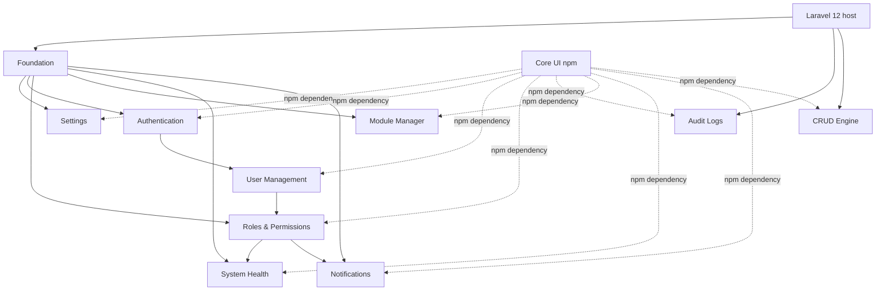
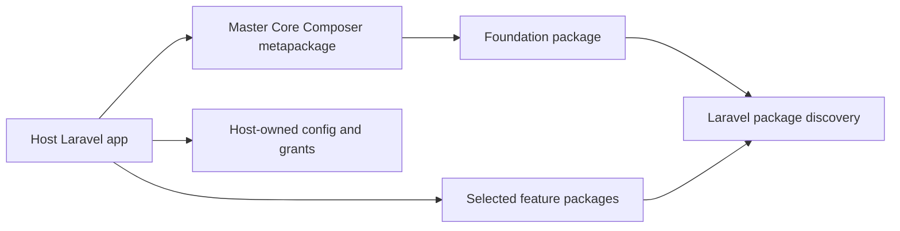

# Phase 10 — Master Core Package Proposal

> **Status: IMPLEMENTED (2026-11-15)**
> **Scope:** Approved lean Composer/npm distribution architecture. External registry publication remains pending vendor and repository ownership decisions; see the [implementation report](phase10-master-core-package-implementation-report.md).

## 1. Purpose

Prepare the existing independently maintained Core packages for a cohesive, installable distribution that can be selected by Laravel host applications without requiring every feature. The distribution should make package compatibility, installation, registration, configuration, frontend composition, and upgrade behavior predictable while keeping each module's security and data ownership intact.

The repository already has a functional package monorepo and a Laravel development host. The main gap is not a missing runtime CRUD or module system: it is the absence of a release/distribution layer and a documented consumer installation contract.

## 2. Inspection findings

### 2.1 Observed repository structure

- The repository root is a Laravel 12 **development application** (`example/laravel-master-core-development-app`), not a distributable Core package. It requires all backend Core packages and registers all feature packages as Composer path repositories with symlinks disabled.
- Laravel packages live in `packages/core/*`. Each backend package has Composer metadata, PSR-4 autoloading, and a Laravel package-discovered service provider. Composer discovery is a package registration mechanism, not a Core-wide installer.
- The root `package.json` is an npm workspace containing Core UI and the Vue packages. Feature UIs are separate npm packages and import the shared `@master-core/ui` package.
- The Auth application shell manually imports each chosen Vue route factory from `resources/js/auth.ts`; Settings has a separate `resources/js/settings.ts` entrypoint. There is no generated frontend manifest or central frontend package selector.
- Package providers independently merge configuration, publish package-specific config, load package migrations, append middleware, or load API/web routes as needed. Foundation publishes `master-core-config`; feature packages use their own tags. Many route providers use route-cache and duplicate-route guards.
- Package-owned migrations are loaded by their respective providers. Composer package discovery does not run migrations, but the **development host's explicit setup script** includes `php artisan migrate --force`; this script must not be copied into a consumer installation flow.
- Phase 6 owns a code-defined ability registry and Gate integration. Permission materialization does not grant access. Phase 7 owns a closed event catalog and explicit audit contract. No package-distribution layer may invent executable abilities, grant roles, or automatically audit all events.
- The Module Manager uses a code-defined allowlist and reports Composer installation/provider state. It does not install, activate, migrate, or remove packages. Its current catalog omits the CRUD Engine, which remains intentionally opt-in and has no production routes or migration.
- The CRUD Engine is a Composer/npm workspace package with a test-only fixture. Its implementation report records no real-resource adoption. That boundary must remain intact.
- Composer names use `example/` placeholders. npm packages are marked `private`, use local source exports, and are not configured for registry publication. No public/private Composer or npm distribution is configured.
- Package dependency constraints currently use `dev-main` between local packages; package npm versions are mostly `0.1.0` (CRUD Engine is `1.0.0`). There is no release compatibility matrix or established stable vendor namespace.
- The root Composer project contains convenience scripts and dev tooling. Its `post-autoload-dump` runs Laravel package discovery, and its `setup` / `post-create-project-cmd` flows include application setup and migrations. These are development-host behaviors, not safe package installer defaults.

### 2.2 Current package inventory and ownership

| Package | Current backend relationship / responsibility | Frontend | Data / registration notes |
|---|---|---|---|
| Foundation | Depends on Laravel 12 | None | Shared config and health route; no database table. |
| Settings | Requires Foundation | Settings UI + Core UI | Owns settings table, middleware, config, and routes. |
| Authentication | Requires Foundation, Fortify, Sanctum | Auth shell and route composition | Uses host identity and Laravel stock auth tables. |
| User Management | Requires Foundation and Authentication | User routes/pages | Adds approved account-lifecycle columns to the configured host user table. |
| Roles & Permissions | Requires Foundation and User Management | Roles and permission pages | Owns RBAC tables and Gate compatibility behavior. |
| Audit Logs | Laravel-only declared dependency | Audit log route/page | Owns its append-only table and explicit catalog; integrations use explicit contracts/events. |
| Module Manager | Requires Foundation | Module catalog route/page | Read-only code catalog; no table and no lifecycle actions. |
| System Health | Requires Foundation and Roles & Permissions | Health route/page | Authenticated read-only checks; no table. |
| Notifications | Requires Foundation and Roles & Permissions | Notification Center | Owns recipient-scoped inbox table. |
| Core UI | No Composer package | Shared Vue components and styles | npm-only foundation for current Vue controls. |
| CRUD Engine | Declares Laravel dependency | Composable and limited descriptor renderer | No production CRUD routes/schema; opt-in resource owner integration. |

The dependency graph below captures package requirements declared in Composer metadata. It is not a recommendation that all packages be installed together.

This graph excludes runtime event integrations that intentionally avoid a hard Composer dependency. For example, package discovery does not itself prove that a host has completed its Auth, permission, database, or audit setup.

### 2.3 Findings and risks

1. **No installable entry point or release source.** A consumer cannot install the current placeholder Composer packages from a configured public/private repository. The root path repository works only inside this checkout.
2. **All-features development host differs from optional consumer installs.** Root Composer/npm manifests require nearly every feature, so they do not exercise clean minimal or partial package selections.
3. **Backend and frontend selection are separate.** Composer package discovery registers installed providers, while the consuming Vue shell must separately import selected npm packages and route factories.
4. **Installed does not mean configured or ready.** Provider discovery may load routes, middleware, event listeners, and migration paths, but host auth, permissions, settings, migrations, role grants, and deployment review remain separate.
5. **No central feature activation contract.** Module Manager is read-only. Removing a Composer package does not roll back its migration or delete stored data. A generic enable/disable switch could leave routes, middleware, listeners, and data in inconsistent states.
6. **Provider registration patterns vary.** Some providers register migrations, some append global web/API middleware, and route prefixes may inherit Foundation defaults or use package-specific config. Centralizing this behavior risks changing established contracts.
7. **Package version constraints are development-only.** `dev-main` dependency links and mismatched npm versions do not establish release compatibility or safe upgrades.
8. **npm exports expose source files.** Current packages are local/private workspaces whose export maps point to TypeScript source. A published consumer contract needs a built artifact, declarations, Vue SFC handling, CSS exports, and a tested peer/dependency policy.
9. **Module catalog drift.** CoreModuleRegistry is a manually maintained allowlist and currently excludes CRUD Engine. Adding an installable package should not automatically imply runtime activation or a CRUD API.
10. **Potential installation hazard from copied host scripts.** The development host's explicit setup flow runs migrations. Consumer installation instructions must never run migrations implicitly or claim that Composer discovery performs migrations.
11. **Historical phase number collision.** Notifications is already documented as Phase 10, and CRUD Engine was separately requested under Phase 9 despite System Health also carrying that number. This new Phase 10 packaging proposal reuses the existing Notifications number. Preserve all existing records; the roadmap needs a later naming/numbering decision.

## 3. Recommended package architecture

### 3.1 Composer distribution model

**Recommendation:** keep the existing monorepo as the source of separately versioned packages and add a Composer **metapackage entry point** only after the vendor identity and release repository are approved.

- The entry point should depend on Foundation as the minimal shared backend baseline and declare other Core capabilities as Composer `suggest` entries with dependency and setup notes.
- Consumers install optional capabilities by requiring their individual package. Composer's dependency solver then installs their declared prerequisites (for example User Management brings Authentication and Foundation).
- Do not make the entry point a runtime package with an all-feature service provider. There is no need to duplicate providers or define a second route/migration loader.
- Do not make every feature mandatory. Avoid a single “full Core” metapackage as the default because it forces authentication, RBAC, audit, persistence, and UI decisions on every host. A curated full profile could be considered later as an explicitly named convenience package.
- Do not let package installation assign roles, materialize permissions as grants, run migrations, create a first user, or modify host authentication configuration.

The Master Core entry point is metadata, not a runtime authority. Every installed feature remains the owner of its provider, configuration, migrations, routes, permissions, events, and documentation.

### 3.2 npm/frontend distribution model

**Recommendation:** publish Core UI and each Vue capability as separate npm packages, and keep host composition explicit.

- Keep `@master-core/ui` as the shared UI dependency with Vue as a peer dependency.
- Give each optional feature package explicit public exports for compiled JavaScript, TypeScript declarations, and any CSS entry points. Do not publish raw workspace source as the only consumer contract.
- Keep route factory functions and API-base configuration explicit. A host includes only route factories for packages it installed and wants in that SPA.
- Keep Core UI imports and styling centralized in the host entrypoint where practical; avoid duplicate stylesheets or bundled Vue copies.
- Do not create an all-feature frontend barrel that statically imports every optional package. That would make all modules build-time requirements and defeat optional Composer/npm selection.
- Consider a small host integration helper only if repetitive route/API wiring remains after real consumer validation. It must accept explicitly selected packages and must not discover arbitrary modules or substitute for backend authorization.

### 3.3 Feature installation and activation

**Recommended v1 meaning:** a feature is backend-installed when its Composer package is present and Laravel package discovery has registered its provider; it is frontend-present only when the host installs/imports that feature's npm package and route factory.

- Keep Module Manager read-only; it reports presence and dependency/provider state but does not mutate Composer manifests, enable providers, run migrations, or uninstall modules.
- Do not add a central database-backed activation registry or runtime code loading.
- A provider being loaded does not mean the feature is ready. Each package's setup guide must state configuration, migration, auth/permission prerequisites, and UI registration.
- Package removal is a deployment operation. It removes provider routes/listeners on the next Composer discovery/cache rebuild but does not reverse migrations or erase data. Data cleanup requires the package's documented rollback and host approval.
- If runtime disable switches are later needed, define them per package and ensure they gate routes, middleware, commands, listeners, and UI consistently. A global switch is not proposed for v1.
- Reconcile the Module Manager catalog as an explicit allowlist, including a CRUD Engine descriptor only if approved. Its presence must remain informational and must not expose fixture endpoints or convert registered resources into automatic CRUD routes.

## 4. Composer integration and package discovery

After the distribution identity is approved:

1. Publish each PHP package under an owned vendor namespace with real release constraints; replace `example/` and `dev-main` only in the distribution workstream after repository/tagging strategy is selected.
2. Define the meta-package's package type and dependency/suggest contract. It should contain no migrations, service provider, Composer scripts, or post-install migration hooks.
3. Keep each feature's `extra.laravel.providers` declaration as the source of Laravel auto-discovery. Honor `dont-discover` and document explicit provider registration only for hosts that disable discovery.
4. Preserve route cache guards and package-owned route prefixes. The aggregator must not add duplicate global routes or override host `api_prefix` behavior.
5. Keep configuration package-owned and publishable using existing package-specific tags. Foundation's `master-core-config` remains the Foundation config tag; do not copy all feature config into one competing file.
6. Composer install/discovery must not execute database migrations. A consumer should explicitly inspect and run the selected packages' migrations during its controlled deployment.
7. Do not force-publish configuration over host-owned files. Document config caching and route caching after the host has reviewed published overrides.

The repository's path repositories remain useful for development and package tests, but are not a consumer distribution channel. A VCS or private Composer repository is recommended until a public vendor/publishing decision is made.

## 5. API, permission, and audit integration

- Keep each backend package's route files, middleware, controllers, validation, response contracts, and API prefix behavior owned by that package. Do not add a generic Master Core route registrar that bypasses those boundaries.
- Keep Laravel authentication host-compatible. Authentication continues to use the configured host user model and Sanctum/Fortify integration; no separate Core user table/model is part of packaging.
- Preserve Phase 5 account-status checks and endpoint behavior. Do not require every host to install User Management unless a selected package declares that dependency.
- Preserve Phase 6 Compatibility Mode as the default and Strict Mode as opt-in. A distribution may document ability requirements, but must not register executable permissions from arbitrary configuration, issue role grants, or assign Super Admin.
- Permissions remain code-registered by the owning feature and materialized/granted only through the approved host workflow. Frontend visibility remains a usability aid; backend Gates/Policies authorize every request.
- Preserve Phase 7's explicit catalog and failure semantics. Critical mutations record catalogued audit events inside their business transaction; authentication audit failures remain fail-open as approved. The umbrella package must not add a blanket Laravel event listener or synthesize audit names.
- Keep Settings public allowlists, private authorization, Audit Logs read-only behavior, Notifications recipient scoping, Module Manager read-only behavior, System Health read-only behavior, and CRUD Engine resource-owner authorization unchanged.
- Package dependency metadata should represent hard code dependencies only. Event contracts may remain optional/decoupled when documented and tested; a Composer suggestion or setup check should explain optional integrations rather than creating a circular dependency.

## 6. Configuration, publishing, and setup documentation

The future consumer documentation should provide:

- A minimal install path (Foundation only) and separate optional install commands for Settings, Authentication, User Management, RBAC, Audit Logs, Module Manager, System Health, Notifications, and CRUD Engine.
- A package matrix with PHP/Laravel versions, declared Composer dependencies, frontend package names, migration ownership, required host configuration, permissions, and setup order.
- Composer auto-discovery behavior, `dont-discover` override instructions, provider diagnostics, route/config cache rebuilding, and package discovery commands.
- Per-package configuration publication commands/tags and a rule to review published diffs rather than force overwrite.
- A frontend example that installs only selected npm packages, imports route factories explicitly, sets API bases, includes Core UI styles once, and builds against supported Vue/Vite/TypeScript versions.
- An explicit deployment checklist for reviewing migrations and backups, provisioning permissions through the approved process, checking host policies, then building frontend assets. Documentation must separate package installation from database migration and role provisioning.
- Troubleshooting for missing providers, duplicate routes, missing peer dependencies, unsupported PHP/Laravel versions, migration ownership, 401/403 responses, and stale route/config caches.

## 7. Version compatibility and upgrades

**Recommendation:** use a coordinated Core release train for the first distributable release while retaining package-level installation. Each release should publish compatible tags for the metapackage and its feature packages, and a machine-readable compatibility matrix should identify PHP, Laravel, Vue, and peer package ranges.

- Replace `dev-main` constraints with stable semver constraints before public/production distribution.
- Keep Composer and npm package versions aligned at the release-train level for a release, even if package patch versions differ when independently maintained.
- Use lockfiles in host applications; do not recommend unbounded updates in production.
- Treat schema migrations as additive, package-owned upgrades. Do not auto-run migrations on install/update. Document backups, reviewed migration SQL, maintenance expectations, and rollback/data-loss limits per package.
- Test upgrade paths from the previous supported Core release, including dependency resolution, package discovery, cached routes/config, and package-owned migrations on isolated SQLite and MySQL databases.
- Maintain a deprecation policy for API routes, permission keys, audit event names, config keys, and Vue exports. Do not silently change existing host authorization fallbacks.

## 8. Phase 11 Project Generator compatibility

Phase 11 can consume a stable package manifest and compatibility matrix to generate a host-specific dependency selection and installation guide. The generator should:

- Ask which approved packages to include and resolve declared dependency chains before generating files.
- Produce Composer/npm manifests and explicit SPA route imports for the selected package set, not install all optional features by default.
- Leave host User model, stock migrations, authentication policies, permission grants, Super Admin assignment, secrets, and production database migration under explicit host control.
- Include package-owned setup and migration instructions without running them automatically.
- Preserve package ownership and make generated overrides visible and reviewable.

The generator must not become a package activation bypass, authorization grant tool, or arbitrary model/table CRUD generator. No Phase 11 implementation is authorized by this proposal.

## 9. Testing strategy

1. **Composer resolution:** validate every package and the meta-package; install minimal Foundation-only, representative optional selections, and the documented recommended profile in clean Laravel 12 fixtures.
2. **Discovery:** assert only installed provider packages are discovered; test `dont-discover`, explicit provider registration guidance, route cache, config cache, and duplicate-route guards.
3. **No hidden actions:** assert Composer install/update does not run migrations, grant permissions, provision Super Admin, or mutate host user migrations/configuration.
4. **Package regression:** run each package suite and a full integrated Laravel test suite using isolated databases. Add a supported MySQL integration job for cross-engine migrations/constraints where available.
5. **Optional dependency matrix:** test User Management/RBAC chains, Audit Logs absent/present behavior, Notifications event integration, and minimal installs without importing absent package classes.
6. **Frontend packaging:** build and pack each npm package; install packed artifacts into a clean Vue 3 host fixture; verify declarations, Vue SFC exports, CSS, peer dependencies, tree-shaking, route composition, TypeScript, and tests.
7. **Security regressions:** preserve backend 401/403 authorization, Phase 5 inactive-account restrictions, Phase 6 Compatibility/Strict behavior, Phase 7 event failure rules, and CRUD Engine opt-in/resource-owned scopes.
8. **Upgrade tests:** resolve locked prior-release dependencies, run migrations only in isolated test databases, and verify documented rollback behavior.
9. **Manual acceptance:** test a clean Laravel 12 host with only Foundation, then with selected features, including browser navigation, accessibility, auth/CSRF, server errors, and the selected database.

## 10. Risks and mitigations

| Risk | Mitigation |
|---|---|
| A “Master Core” package makes all features mandatory | Use a lean metadata entry point and individually selectable feature packages; make any full profile a separately named opt-in. |
| Provider discovery activates routes/middleware earlier than a host expects | Document installed-provider semantics and test discovery/cache behavior; keep per-feature readiness/setup separate from package presence. |
| Package uninstall is mistaken for data rollback | State clearly that uninstall never reverses migrations or removes data; require reviewed package-owned rollback procedures. |
| Placeholder names and `dev-main` leak into releases | Block release until vendor identity, repository source, stable constraints, and compatibility policy are approved. |
| npm source exports work locally but not in consumer builds | Publish built entrypoints/declarations/styles and test packed artifacts in a clean host fixture. |
| Frontend aggregator imports absent optional packages | Keep route composition explicit and feature packages separately installable. |
| Central setup overwrites host config or runs migrations | Keep config package-owned; no forced publishing or migration hooks in the distribution package. |
| Phase 6/7 integration becomes implicit or broad | Keep code-owned ability/event registries, no automatic grants, and explicit event catalog selection. |
| Module Manager is interpreted as a package installer | Retain read-only semantics; report package/provider state only. |
| Reused phase numbers confuse operators and generated docs | Preserve historical records and approve a canonical roadmap naming/numbering scheme before implementation/release. |

## 11. Implementation stages after approval

1. Resolve roadmap naming, vendor identity, repository visibility, and supported compatibility matrix.
2. Approve the lean Composer entry-point contract and the optional package selection list.
3. Define npm registry/distribution and built artifact/export contract.
4. Implement packaging metadata and release automation without changing feature behavior.
5. Add clean-host Composer/npm installation fixtures and optional-package matrices.
6. Document install, setup, configuration, permissions, migration review, upgrades, and troubleshooting.
7. Reconcile Module Manager's allowlist with approved installable capabilities, including whether CRUD Engine should be listed.
8. Run full regression, packaging, database-isolated, frontend artifact, and manual host acceptance.
9. Publish only after all release, security, migration, and compatibility checks pass.

## 12. Original planning checklist (superseded)

These prompts are retained as part of the inspection record. The approved decisions and implementation status in Section 13 supersede them.

1. **Distribution form — recommend a lean Composer metapackage** that requires Foundation and suggests optional feature packages; keep feature packages independently installable. Should a separate all-features profile be published?
2. **Vendor identity and repository — unresolved:** approve the Composer/npm vendor names, public versus private registries, and source repository before replacing `example/` and `private: true` metadata.
3. **Activation semantics — recommend package installation/provider discovery as backend activation**, with explicit npm route imports for frontend activation; no central runtime switch or database-backed module activation in v1.
4. **Runtime coordinator — recommend no all-feature provider or static imports** in the entry package. Keep registration in each package and composition in the host.
5. **Versioning — recommend a coordinated first release train** with stable semver dependency constraints and a published compatibility matrix.
6. **Frontend packaging — recommend separately published built npm packages** with declarations, CSS exports, and Vue peer dependency; no all-feature frontend bundle by default.
7. **Configuration — recommend preserving package-owned config and publish tags**, with no forced overwrite or automatic migration.
8. **CRUD Engine catalog — recommend adding an informational allowlisted descriptor to Module Manager during implementation**, while keeping routes/schema opt-in and the fixture test-only.
9. **Core UI and optional minimum — confirm Foundation as the only mandatory Core package**; Auth, Settings, RBAC, audit, and other capabilities remain separately selectable subject to declared dependencies.
10. **Phase numbering — unresolved:** this proposal uses Phase 10 while Notifications already has Phase 10 and System Health/CRUD Engine share Phase 9. Approve a canonical phase naming/numbering resolution before implementation or specify that historical labels remain and this packaging work keeps the requested label.
11. **Support matrix — recommend Laravel 12, PHP 8.2+ (CI on PHP 8.2 and 8.4), Vue 3, and MySQL 8 with SQLite in-memory package tests; confirm any broader target versions.**

## 13. Implementation outcome

The implementation follows the user's approved decisions:

1. The Composer entry is a lean metapackage with Foundation as its baseline and optional capabilities suggested for individual selection. No all-features metapackage was added.
2. Composer `example/` and npm `@master-core/` names remain placeholders because no repository origin or namespace ownership could be verified. External publication is blocked until ownership and repository details are supplied.
3. Composer selection and Laravel package discovery register backend packages only. Frontend route and stylesheet imports remain explicit in the host.
4. There is no all-feature runtime provider, route aggregator, migration hook, permission grant, or Super Admin provisioning behavior in the metapackage.
5. Internal package constraints use SemVer-compatible `^0.1.0` constraints. The local profile targets Laravel 12, PHP 8.2+, and Vue 3; broader CI and MySQL compatibility remain release acceptance work.
6. Core UI and each feature UI are independent npm workspaces with compiled JavaScript, declaration, and stylesheet exports. Vue remains a peer dependency.
7. Providers continue to own their configuration, routes, middleware, and migrations. Host route imports and deployment migrations remain explicit.
8. CRUD Engine is present in Module Manager's code-defined informational catalog. Its authorization, opt-in resource integration, and test-only fixture boundary are unchanged.
9. Foundation is the only mandatory Core package; optional packages retain their declared dependency chains.
10. Historical Phase 9 and Phase 10 labels remain preserved. This packaging work retains its requested Phase 10 label.

The approved Phase 10 package implementation is complete. Phase 11 Project Generator compatibility is limited to the versioned package profile contract; no generator was implemented. See the [completion report](phase10-master-core-package-implementation-report.md) and [installation guide](master-core-package-installation.md). No application database migration, permission grant, Super Admin provisioning, Git commit, push, or Phase 11 work was performed.
