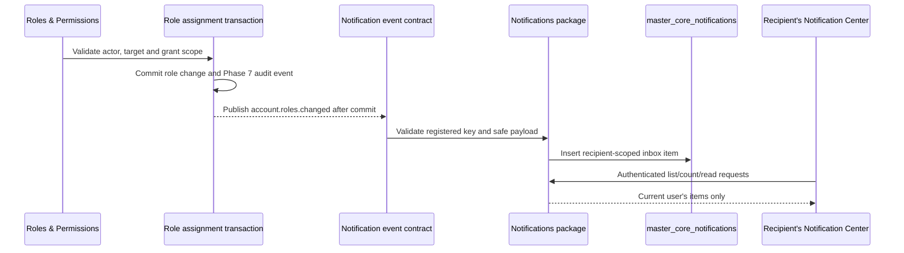

# Phase 10 — Core Notifications & Notification Center Proposal

**Status: IMPLEMENTATION COMPLETE (approved with conditions)**
**Package:** `packages/core/notifications/` (`example/laravel-master-core-notifications`, `@master-core/notifications`)

## 1. Purpose

Add a recipient-owned, persistent in-app inbox to Core. It gives an authenticated user a place to read relevant, explicitly generated application notices. It does not replace Laravel mail notifications, the Phase 7 audit trail, application logs, or operational alerting.

The user approved Phase 10 implementation with conditions. The implementation and verification record is in the [Phase 10 completion report](phase10-notifications-completion.md). The package migration is registered but has not been run against the configured application database.

## 2. Inspection findings

### Observed repository facts before implementation

- The host is Laravel 12 and uses local Composer packages under `packages/core/*`; frontend workspaces are listed in the root `package.json`. The Auth SPA imports package route arrays explicitly from `resources/js/auth.ts` and shares `@master-core/ui`.
- The host `App\Models\User` uses Laravel's `Notifiable` trait. Auth uses Laravel/Fortify's reset and email-verification notification contracts. User Management can request email verification. These are mail/authentication flows, not a Core inbox.
- The host migration set contains users, cache, and queue tables, but no Laravel `notifications` table. The Core database principles assign persistence to the package that owns the capability; Foundation remains persistence-free.
- `CoreToast` is transient feedback for the current page interaction. It does not persist messages or provide an inbox.
- Phase 7 owns an append-only audit event table and explicit security/administration event catalog. It is not a user-notification store, and reads are not automatically converted into notices.
- Phase 9 System Health is a narrow, authenticated, read-only readiness check. It does not include alerting or notifications. Phase 8 Module Manager is a read-only package inventory.
- Phase 6 provides the code-defined permission registry and Gate integration. Permissions are not automatically granted. Its default Compatibility Mode preserves host behavior; Strict Mode is opt-in.
- The authenticated Vue router composes extension routes but `MasterCoreAuthApp` renders a `RouterView`; the current app does not provide a shared navigation shell around all extension pages. A badge displayed on one page therefore would not automatically appear on every Core page.
- The stock queue migration and `config/queue.php` exist. Queue configuration supports multiple drivers and the shipped default is the `database` connection, but a jobs table/configuration alone does not prove a queue worker is running in a deployment.
- `config/services.php` has a Slack notification configuration section, but no inspected Core package dispatches to Slack or provides a general external-delivery system.

### Current notification-related behavior

| Existing behavior | Purpose | Phase 10 relationship |
|---|---|---|
| Laravel password reset and email verification notifications | Authentication email flows | Preserve; do not mirror reset tokens, verification links, or credentials into the inbox. |
| User Management verification request | Requests Laravel's verification notification | Preserve; a toast/API response confirms the request, not persistent delivery status. |
| Core UI toast | Temporary success/error feedback | Reuse for interaction feedback; it is not an inbox record. |
| Phase 7 audit events | Append-only security/administration history | Keep separate; never automatically turn audit rows into user notices. |
| Laravel application/operational logs | Diagnostic and failure reporting | Keep separate from user-facing content. |
| Phase 8/9 pages | Read-only module inventory and health checks | Do not add alerting as a side effect of viewing or probing. |

## 3. Recommendation and v1 scope

Implement **in-app storage and a read-only-content Notification Center with recipient-controlled read state**. Keep external delivery and user preference management out of v1.

| Capability | v1 recommendation | Reason |
|---|---|---|
| In-app notification storage | Include | Establishes the Core-owned inbox capability. |
| Notification Center page | Include | Lets users inspect their own notices. |
| Unread count/badge | Include | Makes unread items discoverable. Show it in the current authenticated `/app` account surface and Notification Center; a global cross-module bell requires a shared-shell change and is a separate approval choice. |
| Mark read/unread | Include | Supports ordinary inbox state without editing the immutable event content. |
| Mark all as read | Include | Useful bounded bulk action, scoped to the current user. |
| Notification preferences | Exclude | There are no approved categories or delivery channels to configure. Do not place user preferences in global Settings. |
| Retention | Configurable policy with manual, bounded purge; automatic purge disabled | Keep destructive cleanup operator-invoked and limited to old read records under explicit approval flags. |
| Email/external delivery | Exclude | Existing Auth email flows remain unchanged. New channels add credentials, retries, queues, provider failure modes, and preference requirements. |
| User delete/dismiss | Exclude | Keep record lifecycle controlled by the retention policy; v1 actions change only read state. |

### Proposed initial notice producer

Start with a narrowly scoped, non-secret `account.roles.changed` notice for the affected active host user when Phase 6 role assignment/removal commits. The content should be generic (for example, “Your account access was updated”), without enumerating grants or exposing role-manager details. Dispatch after the RBAC transaction commits. Do not mirror every audit event, authentication event, settings update, or health check. The initial event and its wording/recipient rule require approval.

The implementation includes the approved producer; other Phase 3–9 actions remain outside the event catalog.

## 4. Separation of concepts

- **In-app notification:** a user-facing, recipient-scoped message stored for later display. Phase 10 owns this capability and its read state.
- **System/audit event:** a record of an action or security-relevant change. Phase 7 owns the audit stream, including append-only and transactional guarantees for its approved events. Audit records are not inbox content.
- **Operational log:** diagnostic information for operators (for example, a failed best-effort notification write). It uses Laravel logging, must be sanitized, and is not shown as a user notice.
- **Email/external delivery:** a channel that sends outside the application, such as the existing password-reset and verification mail. Phase 10 v1 does not add or replace such channels.

The same business action may produce a Phase 7 audit event and a separately defined user notice, but the two records have independent payload allowlists, retention, access, and failure policies.

## 5. Package boundaries and integration

Proposed package contents:

```text
packages/core/notifications/
├── composer.json
├── package.json
├── README.md
├── config/notifications.php
├── database/migrations/
├── routes/api.php
├── src/
│   ├── NotificationsServiceProvider.php
│   ├── Models/CoreNotification.php
│   ├── Contracts/NotificationInbox.php
│   ├── Catalog/NotificationCatalog.php
│   ├── Actions/StoreCoreNotification.php
│   ├── Http/Controllers/NotificationInboxController.php
│   ├── Http/Requests/
│   └── Support/
└── resources/js/
    ├── api.ts
    ├── routes.ts
    └── pages/NotificationCenterPage.vue
```

- Keep the feature in its own Laravel 12 Composer package and Vue 3 + TypeScript npm workspace, following local package naming, provider discovery, route loading, tests, and API prefix/version conventions.
- Depend on Laravel's configured default-guard authenticatable model through the authenticated principal and host integration contract. Validate that model both when storing and reading notices. Do not create a Core user model, change `App\Models\User`, or alter Laravel stock migrations.
- Keep Foundation independent. Do not extend Settings' global settings table for per-user preferences.
- Register the package route array and API-base data through the existing Auth SPA integration points. Reuse Core UI controls, typography, spacing, loading/error/empty states, responsive behavior, and toast feedback.
- Phase 6 permission registry integration is not required for the self-service inbox if every endpoint is authenticated and always scoped to the current user. Do not add a global “view all users' notifications” API in v1. If administration or cross-user access is later needed, it requires a separately registered ability and policy.
- Phase 6 role changes may publish a dedicated notification-domain event or call a stable package contract after commit. They must not depend on the Phase 7 audit database/API. Preserve existing Phase 6 authorization, transactions, audit writes, and compatibility behavior.
- No Phase 3 Settings, Phase 4 Auth, or Phase 5 User Management behavior is replaced. Existing reset/verification mail stays on Laravel's notification contract.

## 6. Data model and database impact

### Proposed single package-owned table

`master_core_notifications` is owned and migrated only by the Notifications package. It is separate from Laravel's stock tables and from `master_core_audit_events`.

| Column | Proposed type | Rules |
|---|---|---|
| `id` | ULID / fixed-length string | Primary key; opaque public identifier. |
| `notifiable_type` | string | Required allowlisted host-user morph type; never accepted from client input. |
| `notifiable_id` | host-compatible string | Required identifier of recipient; no host-user foreign key so custom user keys remain supported. |
| `event_key` | bounded string | Required, code-registered stable event key; not an arbitrary class name. |
| `data` | JSON | Required, bounded allowlisted display payload; no secrets, tokens, arbitrary request bodies, or raw model serialization. |
| `read_at` | nullable timestamp | Null means unread; timestamp means read. Mark-unread sets it to null. |
| `created_at` | timestamp | Required creation time, stored consistently in UTC. |

No `updated_at`, soft deletes, user FK, channel column, provider response, or arbitrary URL is proposed for v1. Indexes should support recipient + reverse chronological listing and recipient + unread count (for example `(notifiable_type, notifiable_id, created_at, id)` and `(notifiable_type, notifiable_id, read_at)`). Confirm composite index lengths and ULID representation for supported MySQL versions during implementation. SQLite and MySQL must both support the migration and scoped queries.

Recipient rows may become orphaned when a host permanently deletes a user. The implementation provides a report-only console diagnostic; no cascade is possible without a host-user foreign key. The diagnostic never deletes rows, including unknown morph types.

No queue, outbox, scheduler, mail table, settings row, stock migration edit, or extra database table is proposed for v1.

## 7. Event contract and creation flow

Use a closed, versioned catalog of notification event keys and per-event payload schemas. Producers submit a stable event key, recipient model from trusted server-side code, and typed allowlisted data. Requests must never be able to create arbitrary notifications, choose another recipient, set `read_at`, or choose a morph type.



For v1, persist in-app notices synchronously after the source transaction commits. Notification storage failure must not roll back an already committed role change; it should emit a sanitized operational log with correlation context and no payload secrets. This is intentionally best effort: a process failure between business commit and inbox insert can lose a notice. If durable delivery becomes mandatory, propose a transactional outbox/queue separately rather than silently making notification availability a prerequisite for RBAC mutations.

Do not automatically translate Laravel events, Audit Logs records, exception logs, or every package action into notifications. Keep notification event names and data schemas independent from Phase 7 audit event names.

## 8. API proposal

Use Foundation's configured API prefix/version, `auth:sanctum`, the existing JSON envelope, and server-side filtering/pagination. Reject unauthenticated requests with 401. All reads/writes must derive the recipient from the authenticated principal and scope each query/mutation to it; return 404 for another user's notification identifier to avoid existence disclosure.

| Method and endpoint | Purpose |
|---|---|
| `GET /api/v1/notifications` | List own notices, filter by `status=all|unread|read`, sort newest first, paginate with allowed per-page values 10, 25, 50, 100. |
| `GET /api/v1/notifications/unread-count` | Return own unread count only. |
| `PATCH /api/v1/notifications/{id}/read` | Mark own item read. |
| `PATCH /api/v1/notifications/{id}/unread` | Mark own item unread. |
| `POST /api/v1/notifications/read-all` | Mark all own unread items read in a bounded set-based update. |

No create endpoint, arbitrary search over payload data, export, delete, restore, bulk recipient action, or administrative all-user listing is proposed. The server validates route IDs, filters, sort allowlist, and pagination bounds. Apply rate limiting to state-changing requests where consistent with existing host API conventions.

## 9. Frontend proposal

- Add a permission-independent, authenticated Notification Center route for the current user; authorization is enforced server-side by `auth:sanctum` plus recipient scoping.
- Display message, creation time, unread state, and only an allowlisted local action link if the event schema defines one. Render message content as text; do not inject HTML. The server must not accept arbitrary external links.
- Include unread count, all/unread/read filters, server-side pagination and sorting, mark read/unread, and mark all as read. Use the documented page sizes and standard Core design for controls, focus states, validation/alerts, loading, error, empty, and responsive behavior.
- Handle 401 by returning to login with a safe local redirect; handle 403 consistently if host policy blocks the page/API; handle a cross-user ID as not found. Frontend visibility is convenience only; API scoping remains authoritative.
- Because there is no shared authenticated navigation shell today, v1 should place the badge/link on the existing authenticated `/app` account surface and within the Notification Center. A persistent bell across all package pages requires a common Auth shell and is an explicit broader choice below.

## 10. Security, privacy, and performance

- Enforce active-account/session policy through the existing Auth/User Management integration; inactive accounts must not gain access through the new API.
- Bind each API request to the currently authenticated configured user; do not accept recipient IDs from the browser. Enforce ownership in the query itself, not only after loading a row.
- Validate registered event keys and event-specific payload allowlists. Exclude passwords, reset/verification links, tokens, session identifiers, credentials, private settings, raw request data, and untrusted HTML.
- Keep payloads small and display-oriented. Bound message lengths, metadata depth/size, list size, and request page size; avoid storing duplicated user profile data.
- Use opaque identifiers, UTC timestamps, safe local routes, escaped text, HTTPS/cookie/CSRF conventions already established by Auth, and rate limits for state changes.
- Store no IP address, User-Agent, or request fingerprint by default; Phase 7's separately approved collection policy applies to audit events, not this inbox.
- Notification contents can reveal private account information. Use a conservative event catalog, retention policy, and host database access controls. Never log message payloads on delivery failure.
- Unread count should be a bounded indexed count query. Pagination must be server-side; do not load an entire inbox in Vue.

## 11. Queue, failure, retention, and deletion

- **Queue/scheduler:** not required for in-app-only v1. Use synchronous after-commit persistence. Existing `jobs` infrastructure is available to hosts, but do not assume a queue worker is configured and running.
- **Failure:** inbox insertion failure is operationally logged and does not fail the already committed source mutation. API read-state failures return standard errors and do not claim success. No retry queue is included; the documented after-commit crash window remains.
- **Retention:** `MASTER_CORE_NOTIFICATIONS_RETENTION_DAYS` is configurable. Automatic deletion is disabled by default. An explicit manual purge command requires the host's approved/enabled flags, deletes only old read rows, and is bounded by an operator-supplied batch limit. No scheduler is installed.
- **User deletion:** no FK/cascade against host users. `master-core:notifications:report-orphans` is report-only; it does not remove rows for missing or unresolved recipient types.
- **External delivery:** email, SMS, push, Slack, webhooks, delivery preferences, retry queues, provider credentials and delivery-status tracking are out of scope.

## 12. Permission requirements

No Phase 6 ability is recommended for self-service inbox access in v1. `auth:sanctum`, the active-user checks, and strict ownership scoping provide the access boundary, while a permission grant requirement would prevent ordinary users from using an account-level feature unless a host explicitly granted a new ability. No permission is automatically materialized or granted.

If an administrator-wide inbox or notification management interface is later requested, register a specific Phase 6 ability (for example `view-all-notifications`) before implementation and define its policy, audit requirements, and recipient privacy limits. Do not add `manage-notifications` merely to authorize each user's own read state.

## 13. Testing strategy

Backend tests cover package discovery and migration schema on SQLite `:memory:`, registered event keys and payload allowlists, authenticated access, inactive account rejection, configured-recipient validation, recipient isolation (including 404 for another user's ID), unread counts, filters, pagination limits, read/unread/read-all scoping, after-commit timing, successful Phase 6 role assignment integration, duplicate event delivery, safe logging on post-commit persistence failure, report-only orphan behavior, and disabled/default/bounded retention cleanup. MySQL migration/index/query acceptance remains a deployment check.

Frontend tests should cover route integration, loading/error/empty states, count badge, read/unread actions, filter and page behavior, safe text rendering, 401/403 handling, and absence of create/edit/delete/export actions. TypeScript checks, frontend tests/build, Pint, Composer validation, route/package discovery, and full regression suites are implementation-stage checks. No configured application database migration is needed for SQLite tests.

## 14. Compatibility, upgrade, and deployment

- Target Laravel 12 APIs and the repository's local `example/` Composer identity convention until a vendor namespace is selected.
- Support the configured host authenticatable model and its actual key type; use no `App\Models\User` hard-code or host-user FK. A representative custom non-integer host key was not tested and remains a host acceptance check.
- Do not depend on the Laravel database notification model because it is fixed to the stock `notifications` table; use the package-owned model/table and explicit payload contract. Keep existing mail notification channels untouched.
- The package adds one independently owned migration. Hosts must review, back up, and explicitly schedule migration deployment; package discovery must not execute migrations.
- Add a focused Composer provider and npm route integration, and extend the existing Auth SPA with only the approved Notification Center integration. Do not refactor all feature pages into a common shell unless that option is approved.
- Document retention, backup/privacy expectations, supported MySQL versions, trusted user-model morph mapping, and any operational logging configuration. No queue worker or scheduler configuration is needed for v1.

## 15. Risks and limitations

| Risk or gap | Mitigation / decision needed |
|---|---|
| Existing Auth SPA has no shared navigation shell | Keep v1 badge/link on `/app` and the Center, or explicitly approve a cross-package shell feature. |
| After-commit delivery is best effort | Document the crash window; add an outbox only if guaranteed delivery is required. |
| Host models may use non-integer IDs or custom morph maps | Store polymorphic IDs as strings and validate a representative custom key during host acceptance. |
| Notifications can become private data with long retention | Set host retention before production; default to no automatic purge and keep payloads minimal. |
| Native Laravel database notifications use a fixed `notifications` table | Use a package-owned model/table and do not add or modify stock notification migration. |
| Host may configure `QUEUE_CONNECTION=sync` or have no worker running | V1 does not require queue workers; external channels remain out of scope. |

No conflict with approved Phase 1–9 architecture is identified. The main constraints are keeping Foundation persistence-free, preserving host identity and Laravel stock tables, keeping Audit Logs separate, respecting Phase 6's no-auto-grant registry, and making the SPA shell/badge choice explicit.

## 16. Implementation sequence completed

1. Added the Composer/npm package, provider, configuration, owned migration/model, closed catalog, and idempotent event contract.
2. Added authenticated self-only API routes, validation, retention/orphan commands, and SQLite security tests.
3. Added the Notification Center and unread badge on the existing `/app` surface.
4. Integrated the approved Phase 6 role-change events after commit and added the package to the Phase 8 code-owned module inventory.
5. Updated package/architecture documentation and ran the tests and static/build/package checks listed in the completion report.

## 17. Approved decisions and implementation status

The following choices were approved through the Phase 10 implementation authorization and are implemented:

1. **Package and table:** separate Composer/npm package and one package-owned `master_core_notifications` table.
2. **V1 channels/actions:** in-app only; list/count, read/unread, and mark all read; no preferences, external delivery, create API, delete/dismiss, export, or cross-user inbox.
3. **Authorization:** authenticated active configured host users can access only their own inbox. No Phase 6 permission is required or registered for this self-service scope; the implementation request's permission bullet follows this approved proposal decision.
4. **Producer and badge:** generic `account.roles.changed` notice after successful Phase 6 assignment/provisioning commit; the badge/link is on `/app` and the Notification Center, with no shared-shell refactor.
5. **Retention/orphans:** configurable retention is disabled by default; manual bounded purge requires explicit approval flags and affects only old read rows. Orphan reporting is report-only.
6. **Failure and replay:** notification insertion is best effort after commit; failures are logged without secrets; source transactions remain committed. Same-event replay is idempotent through the role event ULID.
7. **Verification limits:** SQLite tests and local build checks pass; MySQL, browser acceptance, and custom host-user key verification remain deployment checks.

No automatic application database migration was run. Phase 11 has not started.
