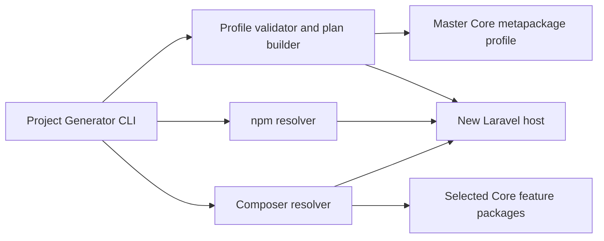

# Phase 11 — Project Generator Proposal

> **Current status - 2026-11-19:** The public GitHub global CLI and existing-app template generation passed end to end; all 12 Composer packages resolve from monorepo paths. The separate feature-selection registry mode retains its trusted-source checks. The application/CLI `1.0.0` release candidate is local and unpublished pending authorization. See the [implementation report](phase11-project-generator-implementation-report.md), [GitHub acceptance record](../development/github-distribution.md), and [SemVer release guide](../development/release-and-updates.md).

## 1. Purpose

Provide a safe, repeatable way to create a new Laravel host application with Foundation and an explicitly selected set of Master Core features. The generator should produce dependency manifests, selected frontend composition, a machine-readable selection record, and host setup instructions. It must preserve package ownership and must never turn project creation into an implicit migration, permission-grant, or Super Admin workflow.

## 2. Inspection findings

### 2.1 Existing distribution architecture

- The root is an all-features Laravel 12 development host. It is not a project-generator template or a consumer release repository.
- `packages/core/master-core/composer.json` defines a lean Composer metapackage. It requires PHP `^8.2`, Laravel `^12.0`, and Foundation, then lists nine optional features in `suggest` and `extra.master-core`.
- The metapackage profile uses schema version `1` and identifies Composer/npm package names, direct Composer dependencies, frontend entrypoint/export names, style exports, and a package-migration boolean. It also declares that installation does not automatically activate all features, run migrations, grant permissions, or provision Super Admin.
- Composer `suggest` is advisory; Composer does not install those features. A generator must convert the selected feature keys into explicit Composer requirements and let Composer resolve each package's hard dependencies.
- Core Composer packages use the `example/` vendor placeholder, and npm packages use the `@master-core/` scope. The Phase 10 report says no Git repository/remote or namespace ownership was established. These names are not presently resolvable from an owned release registry; real registry-based generation cannot be acceptance-tested until that release gate is cleared.
- Internal PHP package requirements use SemVer-compatible `^0.1.0` constraints. npm packages are version `0.1.0`; Vue is a `^3.5.0` peer. The root development toolchain uses Vue 3, TypeScript, Vue Router, Vite, and npm workspaces. Package manifests do not declare a Node/npm `engines` range.
- Composer metadata and npm exports are separately maintained. Npm export maps point workspace development to source and normal package imports to built `dist` files; each feature has an explicit stylesheet export. A generator must produce only the selected npm packages and must not copy the root all-features workspace.
- The development host's `resources/js/auth.ts` imports all current Auth-SPA feature route factories; Settings has a separate `resources/js/settings.ts` entrypoint. Root Vite includes both. This is an example-host composition, not a generated consumer manifest.
- Laravel package discovery reads each selected package's provider metadata. Providers own their configuration, routes, middleware, and migration registration. Discovery registers package code and migration paths; it does not execute migrations. `dont-discover` can disable individual providers, in which case the host must register them by its own Laravel conventions.

### 2.2 Feature ownership and host requirements

| Feature | Composer dependency chain / owned data | Frontend and host setup considerations |
|---|---|---|
| Foundation | Required baseline; owns no tables. Its migration directory is empty; it publishes `master-core-config`. | Defines the shared API prefix/version. No Vue package. |
| Settings | Requires Foundation; owns `master_core_settings`. | Separate Settings UI entrypoint. Host supplies or installs `view-settings` and `manage-settings` authorization; only explicitly public settings are exposed. |
| Authentication | Requires Foundation, Fortify, and Sanctum; owns no tables and preserves the host User model and Laravel stock migrations. | Auth shell and route helpers. Host must configure Sanctum stateful SPA/CSRF behavior, mail, cookies, and `statefulApi()` where using the Core session SPA. |
| User Management | Requires Foundation and Authentication; adds package-owned account-lifecycle columns to the configured host user table. | Requires a compatible host Eloquent User model and a host safety policy before destructive lifecycle operations. Never replace `App\\Models\\User` or edit stock migrations. |
| Roles & Permissions | Requires Foundation and User Management; owns four RBAC tables. | Requires ability registry review and host rollout choices. Permission sync materializes registered definitions only; role grants and interactive Super Admin provisioning remain operator actions. |
| Audit Logs | Declares Laravel as its direct Composer dependency; owns one append-only table. Its API requires Sanctum and `view-audit-logs`; integrations use optional event contracts. | Read-only UI route factory. Trusted-proxy, privacy, retention, and authorization choices require host review. `export-audit-logs` is registered but no export is implemented. |
| Module Manager | Requires Foundation; no table. | Read-only inventory; host role workflow must grant `view-modules` if RBAC is used. It is not an installer or activation control. |
| System Health | Requires Foundation and Roles & Permissions; no table. | Authenticated `view-system-health` check. It may depend on the same database/RBAC that is unhealthy. |
| Notifications | Requires Foundation and Roles & Permissions; owns one recipient-scoped table. | Auth-SPA route helper. Retention is disabled unless the host explicitly configures and approves it. |
| CRUD Engine | Requires Laravel; no table and no production routes. | Resource-owned opt-in helpers only. Generator must not create generic CRUD routes, resources, abilities, or database schema. |

The profile's Composer dependency map captures hard package relationships, but it does not fully describe host-level setup prerequisites, permissions, optional integration events, exact migration responsibilities, or authentication providers. The `has_package_migrations` boolean is not a substitute for a per-package deployment checklist. Package READMEs remain authoritative for v1 host instructions.

### 2.3 Existing project creation and safety risks

- The root `composer setup` script runs `php artisan migrate --force`. Root `post-create-project-cmd` also generates a key, creates a SQLite file, and runs migrations. These development-host scripts must never be called by a consumer generator.
- The Laravel skeleton's `composer create-project` lifecycle may run project scripts. The generator must disable scripts during scaffold creation, then call only individually approved non-migration setup operations. It must not run a generic setup script.
- The current test setup uses SQLite `:memory:` and is not evidence of host-database safety. Several packages extend or create host tables and require separate database deployment review.
- Auth/package providers may register routes, middleware, and migrations when discovered. Installation is not configuration completion, database readiness, user provisioning, or authorization readiness.
- Settings and several read APIs expect host-defined or code-registered abilities. Phase 6 abilities are not grants. User Management safety policy, RBAC Strict Mode, role provisioning, `manage-user-roles`, and Super Admin provisioning cannot be inferred by the generator.
- **Initial inspection finding (before Phase 11 implementation):** no Project Generator package, command, or executable was present. The standalone CLI and local test workflow are now implemented; see the implementation report for current consumer evidence and the remaining trusted-source gate.

## 3. Recommended architecture

### 3.1 Standalone CLI with interactive and non-interactive modes

**Recommendation:** implement a separate Composer CLI application/package, not an Artisan command in the metapackage and not a web installer. The metapackage is metadata-only and a Laravel Artisan command would require an already-created host. A standalone tool can scaffold a host and keep generator dependencies separate from runtime packages.

Provide an interactive CLI for guided feature selection and confirmations, plus non-interactive flags for automation. Non-interactive runs must require an explicit target path and deterministic feature selections; they must not infer an all-features install. A dry-run should show package resolution, generated files, and manual setup steps without creating files or running package managers.

The tool should have a process-free planning layer that validates the profile, computes feature dependency closure, and returns a typed project plan. A CLI adapter may execute Composer/npm processes using argument arrays. A future web interface may consume the plan layer, but must not execute arbitrary shell commands or write to a server filesystem from HTTP requests.

Proposed commands:

```text
master-core new <target> [--features=...] [--frontends=...] [--core-version=...] [--dry-run] [--json]
master-core plan <selection-file> [--json]
master-core doctor <project-path> [--json]
```

`doctor` is read-only. V1 does not provide update, uninstall, migration, permission-grant, role-provisioning, or project-regeneration commands.

### 3.2 Profile and compatibility resolution

- Resolve an explicit Master Core release or release-train version; do not choose `latest` silently. Use Composer's repository package metadata to read the metapackage's `extra.master-core` profile before installing features, then verify the package profile schema is supported.
- Treat the metapackage profile as the feature-key-to-package-name contract. Use each package's Composer manifest to verify actual hard dependencies, PHP/Laravel constraints, and Laravel provider declarations. Use each npm package manifest to verify package identity, version, dependencies, peer dependencies, exports, and styles.
- Compute transitive Composer dependencies and npm dependencies, detect cycles and unknown feature keys, and present the added packages before installation. Foundation is always selected. Optional packages remain individually selectable; Composer's `suggest` list is never treated as an install command.
- Composer and npm lockfiles are generated for repeatable installs. Keep a coordinated Core release profile and document its supported PHP/Laravel/Vue/Vite/Node/npm matrix. Fail closed for unsupported profile schemas or package compatibility instead of guessing.
- Profile schema v1 is sufficient to identify current packages but lacks complete host setup and compatibility metadata. For reliable generated setup steps, propose a future backward-compatible profile schema revision with machine-readable compatibility ranges, frontend dependency/entrypoint data, configuration publish tags, permission and optional integration identifiers, and migration/setup summaries. Validate duplicated metadata against Composer/npm manifests to prevent drift. Until approved, use explicit documented manual setup steps sourced from package guides and do not synthesize missing host configuration.

### 3.3 Feature-selection model

Keep backend and frontend selection distinct:

- **Backend features:** a list of profile keys. Foundation is mandatory. Selecting User Management implies Authentication and Foundation; Roles & Permissions implies User Management and its prerequisites; System Health and Notifications imply Roles & Permissions and its prerequisites. Display the full closure for approval.
- **Frontend packages:** an independent list for the pages/helpers the host will use. Any selected feature UI pulls in `@master-core/ui` through npm dependencies. Respect each package's declared npm dependencies rather than assuming Composer dependencies imply npm packages.
- **Frontend entrypoint mode:** choose the Core Auth shell, a host-owned router, or no Core UI. Selecting a route helper must not silently replace a host router or force the Auth backend package. The generated output should state any host authentication and authorization adapter requirements.
- **CRUD Engine:** selecting the npm helper does not register a resource or create a route. Resource classes, route definitions, policies, validation, serializers, and audit event choices remain resource-owner work.
- Default to Foundation plus no optional frontend packages when the caller explicitly requests the minimal profile. Interactive selections should default to no optional features. Never create an all-features profile implicitly.

### 3.4 Installation and generated project structure

For a new, absent target path:

1. Preflight PHP, Composer, Node/npm (when frontend is selected), required versions, registry access, profile schema, selected feature keys, permissions to write the parent directory, and free disk space.
2. Resolve the requested profile and dependency closure; show package versions, provider-discovery effects, migration-owning features, frontend entrypoints, and manual requirements. Require confirmation before any network install.
3. Create a fresh Laravel 12 skeleton in a unique sibling staging directory using Composer script suppression. Do not reuse the root repository's `setup` or project-creation scripts.
4. Add the metapackage and explicitly selected Composer packages with a resolved version set. Suppress Composer scripts during package resolution; once files are ready, run Laravel `package:discover` explicitly so selected providers register without running migrations.
5. Add only the chosen npm packages and Core UI when needed. Generate selected route-factory and stylesheet imports in generator-owned frontend files. Keep `auth`, `settings`, and other entrypoints explicit; do not import optional package barrels or root workspace aliases.
6. Generate `master-core.project.json` with a schema version, Core profile/version, selected backend and frontend keys, resolved package versions, and generator version. Do not store credentials or secrets in this manifest.
7. Generate a setup guide listing package-specific config publishing commands, host auth/CSRF/model/policy prerequisites, code-registered permission keys and manual grant steps, package migration owners, migration review order, and verification commands. Generate `.env.example` additions as blank/template values only. Do not put database credentials or production secrets into files.
8. Validate the resulting Composer/npm manifests, selected provider set, route/style imports, and required generated files. Do not execute migrations, permission sync with `--apply`, role grants, or Super Admin provisioning.
9. If generation succeeds and the final target is still absent, move the completed staging directory into place. If any step fails, keep the staging directory and a sanitized recovery report; do not recursively delete it or overwrite an existing target.

The selected package providers register their own configuration, routes, middleware, and migration paths. The generator should not force-publish config. Package defaults are already merged; publish package-owned config only when the host needs explicit overrides, and never use force overwrite.

### 3.5 Environment, migrations, and setup

- Scaffold a new `.env.example` from the Laravel template and add only non-secret Core settings when needed. Create `.env` and generate a local `APP_KEY` only after an explicit user choice; never populate database credentials, SMTP credentials, tokens, or production secrets. Explain how the user provides them securely.
- Never run `artisan migrate`, `migrate:fresh`, `db:seed`, or a generic `composer setup` in v1. Do not add post-install/update hooks that run migrations. `package:discover` is allowed only as a registration step and must be verified not to invoke migrations.
- Generate a package migration checklist from the selected profile plus package READMEs. Identify User Management as a host-user-table extension, Settings/RBAC/Audit/Notifications as package-owned schema, and non-persistent features as having no owned tables. State that the host's single `artisan migrate` operation may apply all loaded app/package migrations, so the operator must review all pending migration files and the target database before running it separately.
- Permission output is informational. List code-registered abilities and package setup references where available, but never execute permission materialization/grants or Super Admin provisioning. Keep Phase 6 Compatibility Mode behavior and host policies unchanged.
- Generate audit setup/privacy/trusted-proxy reminders only for selected Audit Logs and integration packages. Do not generate broad event listeners or infer all business events.

### 3.6 Existing-project detection and regeneration

- V1 `new` requires a target path that does not exist. Refuse to merge into an existing directory, Laravel project, or non-empty folder, even if Core is absent.
- Use a unique staging path adjacent to the target and create the final directory only after validation. Recheck that the final path is absent immediately before the move. If another process creates it, stop and preserve staging output.
- V1 has no automatic regeneration or upgrade. `doctor` may compare the saved selection manifest with installed Composer/npm packages and report drift without writing.
- A future `plan --diff` may render suggested changes in a separate review artifact. It must detect user-modified generated files using a recorded hash/ownership manifest and report conflicts. It must not overwrite or merge a host file automatically. Applying any generated patch should be a separate explicit workflow after approval.

## 4. Compatibility and security requirements

- Support only the explicitly tested Laravel/PHP matrix; current declared baseline is Laravel 12 and PHP `^8.2`. Validate the installed PHP, Composer, Node, and npm versions before creating files. Decide and publish Node/npm and database support before release.
- Run child processes without shell-string interpolation, using structured argument arrays and Windows-safe paths with spaces. Test PowerShell, `cmd.exe` avoidance, path length, Unicode, permissions, cancellation, and process exit handling on Windows as well as Unix-like CI.
- Never log `.env` contents, Composer/npm auth tokens, registry credentials, package manager environment variables, or child-process output that may include secrets. Store generator logs only in the new project/staging area and redact sensitive values.
- Do not accept arbitrary Composer package names, npm package names, Git URLs, PHP classes, commands, paths outside the chosen target, or file templates from request input. Resolve only profile-listed feature identifiers and validated version constraints.
- Treat package discovery as provider registration, not authorization or readiness. Keep backend Gates/Policies, account-status checks, Sanctum/CSRF, host User model, Settings public allowlists, Audit Logs authorization/retention, and resource-owned CRUD controls authoritative.
- Do not mutate Laravel stock migrations or `App\\Models\\User`; do not silently enable Strict Mode, create roles, grant permissions, provision Super Admin, activate arbitrary modules, or generate secrets.
- Generated files and commands must be reviewable. Report package installation failure at the exact stage, preserve completed files for recovery, and provide safe retry instructions without destructive cleanup.

## 5. Dependencies and package boundaries

The generator should be a separate Composer executable package (or PHAR) with a small CLI layer and a process-free plan/profile layer. It must not be a runtime dependency of Laravel hosts or add an installer provider to the Master Core metapackage. The implementation can use Composer's package metadata APIs and Symfony Process/Console if approved; no such dependency is added in this planning phase.

Boundary map:



The CLI owns project creation and file generation. Composer/npm own dependency resolution. Each feature package owns its Laravel integration, migrations, configuration, permissions, and events. The host owns its secrets, database, existing authorization policies, route composition decisions, and migration approval.

## 6. Testing strategy

1. **Profile contract:** parse schema v1 and any approved future schema; reject unknown schema versions, duplicate IDs, missing packages, dependency cycles, invalid exports, and metadata that disagrees with Composer/npm manifests.
2. **Dependency matrix:** resolve Foundation-only; Settings-only; Auth; User Management; RBAC; Audit Logs; Module Manager; System Health; Notifications; and CRUD Engine selections, including transitive dependencies and representative feature combinations.
3. **CLI/preflight:** test supported/unsupported tool versions, invalid feature names, disconnected registries, `--dry-run`, non-interactive required flags, cancellation, process failures, and Windows paths with spaces/unicode.
4. **No hidden work:** use fake process executables and a disposable Laravel fixture to prove scaffold/install does not run migrations, seeders, grants, Super Admin provisioning, or destructive commands. Assert only selected package providers are discovered and `dont-discover` behavior remains documented.
5. **Frontend output:** test frontend selection independently of backend selection; assert selected imports/styles only, Core UI deduplication, separate Settings entrypoint, host-owned auth shell mode, and CRUD Engine produces no resource route.
6. **Host setup generation:** verify environment templates contain no secret values, config publishing never forces overwrite, permissions are informational, migration instructions list only selected package ownership, and user-model notes are emitted only when relevant.
7. **Target safety:** existing/non-empty/project targets are refused; a target appearing during generation is not overwritten; failures preserve stage and sanitized recovery report; `doctor` is read-only; dry-run writes nothing.
8. **Host compatibility:** test fresh Laravel 12 host fixtures on SQLite `:memory:` for package resolution/discovery and no database access. Run package migration acceptance only against disposable databases, including supported MySQL, after separate test approval.
9. **Regression and manual acceptance:** run Core PHP suites, Composer validation, npm packed-artifact tests, TypeScript, production build, clean-host browser/auth/CSRF checks, and manual Windows PowerShell installation with an owned package registry.

## 7. Release and implementation sequence

1. Resolve the Composer vendor, npm scope, source repository, registry permissions, and release tags. Current placeholders prevent real external installation.
2. Approve the supported PHP/Laravel/Vue/Vite/Node/npm matrix and whether the generator requires an owned registry to be available.
3. Approve the project manifest schema and whether to extend `extra.master-core` for host setup, compatibility, permission, and migration summaries.
4. Implement a read-only profile planner and feature dependency graph; add resolver matrix tests.
5. Implement CLI preflight, interactive/non-interactive selection, dry-run, and new-target-only staging lifecycle.
6. Implement Composer installation with script suppression and explicit provider discovery; implement selected npm installation and generated route/style files.
7. Generate project selection metadata, environment template, package-specific setup/migration/permission guidance, and sanitized recovery output.
8. Add target-safety, no-hidden-migration, dependency, frontend, Windows, and fresh-host tests; run release acceptance with actual registries and disposable databases.
9. Publish only after manual acceptance, supported matrix, and namespace ownership are verified.

## 8. Risks and compatibility concerns

| Risk | Mitigation |
|---|---|
| Placeholder namespaces cannot resolve from a consumer registry | Keep generation blocked for external releases until owners approve namespaces, repository source, and access. Use local fixtures for development only. |
| Laravel scaffold scripts run a migration | Suppress create-project/install scripts, avoid root setup commands, and test that no migration command is executed. |
| Profile metadata is insufficient for host setup | Validate against package manifests; use package guide references; approve a schema extension before synthesizing package-specific setup code. |
| Optional Composer/npm packages drift | Read and compare package manifests, compute dependency closure, preserve lockfiles, and fail on mismatch. |
| Composer discovery is mistaken for feature readiness | Report discovery separately from config, migration, permission, auth, and host-policy readiness. |
| Existing project files are overwritten | V1 accepts only an absent target; regeneration/diff is read-only and conflicts are reported. |
| User Management changes an incompatible host model/table | Require host-model preflight and manual setup acceptance; never replace the model or stock migrations. |
| Migration instruction runs on the wrong database | Do not migrate; generate explicit review guidance and require the host to confirm backups, connection, and pending migration list. |
| Generated route list implies authorization | State that frontend visibility is not authorization; retain package backend middleware and Gate/Policy checks. |
| Windows process/path handling differs | Use structured arguments and test paths with spaces, Unicode, permissions, cancellation, and locked files on Windows. |
| Phase numbering overlaps historical records | Preserve Phase 9 System Health/CRUD Engine and Phase 10 Notifications/Master Core Package records; no renumbering is included here. |

## 9. Explicit approval checklist

Please confirm or change these decisions before implementation:

1. **Name and distribution:** approve “Phase 11 — Project Generator” and a standalone Composer CLI/PHAR, separate from the runtime metapackage.
2. **Registry prerequisite:** confirm Composer vendor, npm scope, source repository, and registry must be owned/configured before real consumer installation tests.
3. **Compatibility:** approve Laravel 12 and PHP `^8.2` as the initial supported range; decide the Node/npm/Vue/Vite and database matrix.
4. **Feature defaults:** approve Foundation-only as the minimal profile and require explicit optional feature selections with transitive dependency closure shown before install.
5. **Backend/frontend selection:** approve separate backend and frontend choices, Core UI inclusion only when a selected UI needs it, and explicit Core Auth shell versus host-owned router selection.
6. **Migration behavior:** approve no automatic migration or seeding in v1, including during scaffold creation, Composer scripts, package discovery, and retries.
7. **Environment/secrets:** approve template-only environment generation by default; decide whether local `.env` and `APP_KEY` creation require a separate explicit choice.
8. **Target safety:** approve that v1 requires a nonexistent destination and never merges/regenerates existing projects.
9. **Configuration and permissions:** approve no forced config publishing, permission grants, Super Admin provisioning, or automatic Strict Mode; generate instructions only.
10. **Profile evolution:** approve using profile schema v1 plus manifest validation initially, or require a schema v2 update before implementation to encode setup, compatibility, migration, permission, and frontend metadata.
11. **Version strategy:** approve an explicit Core release-train/pinned version selection with lockfiles rather than silently selecting latest.
12. **Failure recovery:** approve preserving an incomplete staging folder and sanitized recovery report rather than automatic cleanup.

## 10. Implementation boundary

The approved architecture has been implemented as the standalone CLI described in the implementation report. Package selection, compatibility validation, dry-run planning, staging recovery, and read-only doctor behavior are covered by local tests. Real external registry installation and a generated consumer host remain blocked by the placeholder namespace ownership prerequisite. This boundary preserves the historical findings and approval checklist above; it does not claim production release acceptance.
