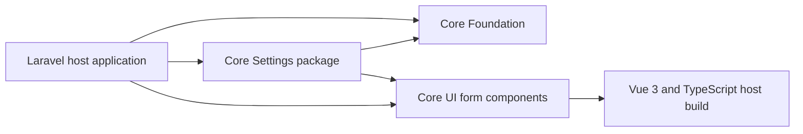

# Phase 3 Proposal: Settings Module

> **Status: APPROVED AND IMPLEMENTED.** This document is the approved Phase 3 specification. Implementation details, deviations, and verification results are recorded in [the Phase 3 completion report](phase3-settings-completion.md).

## 1. Inspection findings

- The host application is Laravel 12 and already requires `packages/core/foundation` through a local Composer path repository.
- Foundation is a Composer library with a Laravel 12 service provider, config publishing, API route registration, and a package migration path. It has no settings persistence and no Eloquent models. Keep it unchanged and independent of Settings storage.
- The host has Laravel's stock users, cache, and queue migrations plus `App\\Models\\User`. They are not Settings-owned schema.
- The host frontend currently has Vite, Tailwind CSS, Axios, a plain JavaScript entry point, and a welcome Blade view. There is no Vue 3, TypeScript, Vue Vite plugin, settings screen, router, or shared Vue design-system component library.
- The current global design requirements are documented in `docs/standards/global-ui-crud.md`; no reusable Vue form components were found to reuse. The Settings proposal therefore includes a small shared Core UI package as a distinct dependency, rather than putting reusable global controls inside the Settings module.
- The host supports SQLite and MySQL configuration. The Settings package must not require Redis; it will use Laravel's configured cache repository.

## 2. Requirements and boundaries

The Settings module will provide one application-wide settings experience covering:

1. **General:** application display name, description, and other explicitly approved non-secret application metadata.
2. **Application Branding:** logo and favicon storage references and approved brand metadata. Store file paths/references, not binary data, in the database.
3. **Localization:** default and fallback locale, supported locale choices, and application timezone.
4. **Date and Time Formats:** approved date, time, and date-time display formats.
5. **Currency:** supported currency code, symbol, precision, symbol position, and separators.
6. **Appearance:** application-wide default theme and approved accent or brand tokens; no per-user preferences in this module.
7. **System:** safe application-level defaults such as default page size. Do not store deployment secrets, credentials, `APP_KEY`, database connection values, mail/API secrets, debug state, or arbitrary server paths.
8. **Settings API:** authorized administration endpoints plus a narrowly allowlisted public read endpoint, if public branding/settings are needed.
9. **Validation and persistence:** server-side allowlisted keys and rules, atomic group updates, code-defined defaults, and database-backed overrides.
10. **Settings cache:** use Laravel's configured cache store with scoped keys and explicit invalidation; do not require Redis or flush the host application's entire cache.
11. **Vue 3 + TypeScript UI:** responsive grouped forms, shared form controls, validation, loading/empty/error feedback, and save/reset actions.
12. **Global Form Design Standard:** introduce reusable form primitives for future modules because none currently exist in the host.
13. **Automated tests and documentation:** isolated persistence/API tests, Vue component/type checks, package setup, API, security, and configuration documentation.

Settings are application-wide in this proposal. Tenant-level and user-level settings are excluded. Generic Settings is not an audit-log or module-registry system.

## 3. Architectural dependencies



- Keep the dependency one-way: Settings may use Foundation's API prefix/version conventions, but Foundation must not depend on Settings, its models, migrations, cache, or configuration.
- Package names should follow the existing reserved `example/` placeholder convention until an owned vendor identity is selected. Proposed names are `example/laravel-master-core-settings` and `example/laravel-master-core-ui`.
- The Settings Composer package requires PHP `^8.2`, Laravel Framework `^12.0`, and the local Foundation package. It has PSR-4 autoloading, Laravel provider auto-discovery, config publishing, API/web route registration, and package-owned migrations.
- The Core UI package is a frontend package with Vue 3 peer dependency and TypeScript sources. Root npm workspaces/Vite integration can build the UI and Settings package assets without moving their sources into Foundation.
- The host has Tailwind 4 but no established Vue design system. Reuse its Tailwind pipeline and typography baseline; centralize shared form tokens and controls in Core UI. Do not build a DataTable for this form-oriented Settings page.
- Settings APIs/pages must use host-supplied authentication and authorization middleware/Gate abilities. Do not implement authentication or user management here. Administrative routes must fail closed when a host has not configured the required authorization integration.
- Add meaningful comments in PHP, CSS, HTML, JavaScript, TypeScript, and Vue only when they explain intent, constraints, non-obvious behavior, or tradeoffs; keep them current and avoid restating code.

## 4. Proposed Settings database schema

### Required table: `master_core_settings`

This is the only table proposed for Phase 3. Package-owned migration location: `packages/core/settings/database/migrations/`.

| Column | Proposed type | Nullability | Purpose |
|---|---|---:|---|
| `id` | Laravel `$table->id()` (`BIGINT` auto-increment) | No | Primary key. |
| `group_name` | `VARCHAR(64)` | No | Stable group slug such as `general` or `currency`. |
| `setting_key` | `VARCHAR(128)` | No | Stable key within the group, normalized to lowercase dot/snake notation. |
| `value` | JSON | Yes | Serialized override value. A missing row uses the code-defined default; `null` is allowed only where a definition allows it. |
| `created_at` | nullable timestamp | Yes | Laravel creation timestamp. |
| `updated_at` | nullable timestamp | Yes | Laravel update timestamp and cache freshness metadata. |

- **Primary key:** `id`.
- **Foreign keys:** none. Settings do not depend on a host user or another module.
- **Unique constraint:** `(group_name, setting_key)` prevents duplicate keys within a group.
- **Indexes:** the composite unique index also supports group/key lookups. No additional index is proposed for this small key-value table.
- **Migration/dependency order:** this is the only proposed table and has no foreign-key dependencies, so it is created in one package-owned migration. There is no separate parent/child ordering.
- **Nullable fields:** only `value`, and only for definitions that explicitly accept null.
- **Timestamps:** `created_at` and `updated_at`; Eloquent maintains them.
- **Soft deletes:** none. Settings have a code-defined default; reset removes the stored override. Trash/restore is not meaningful for this registry.
- **Relationships:** none.
- **Rollback:** the package migration can drop only `master_core_settings`; this removes saved overrides. Rollback must be run only against an approved isolated or backed-up target, never the host's unrelated stock tables.
- **Value definitions:** defaults, labels, data types, validation rules, sensitivity, and public visibility are maintained in package configuration/definitions, not client-controlled database flags. Credentials and deployment secrets are not accepted for storage.
- **Public exposure:** only keys explicitly marked public in server-owned definitions can be returned by the public API. Unknown keys and private definitions are never included. A request cannot change visibility.

There are no seeders: defaults live in code, and the database stores only overrides. The data dictionary is limited to the table above; future tables require separate approval.

## 5. Backend package structure

```text
packages/core/settings/
├── composer.json
├── README.md
├── config/settings.php
├── database/migrations/
├── routes/api.php
├── routes/web.php
├── resources/views/settings.blade.php
├── resources/js/
├── resources/css/
├── src/
│   ├── Contracts/SettingsRepositoryInterface.php
│   ├── Data/SettingDefinition.php
│   ├── Http/Controllers/SettingsController.php
│   ├── Http/Requests/UpdateSettingsRequest.php
│   ├── Models/Setting.php
│   ├── Providers/SettingsServiceProvider.php
│   └── Services/SettingsManager.php
└── tests/
    ├── Unit/
    └── Feature/

packages/core/ui/
├── package.json
├── tsconfig.json
├── src/components/forms/
├── src/styles/
└── tests/
```

This is a proposed layout, not created files. Keep classes limited to current responsibilities; do not add generic repository/DTO layers if a simpler Laravel service and Form Request suffice. The exact interfaces may be reduced during implementation review.

## 6. Global form design and Settings UI

Core UI should establish reusable, accessible Vue 3 + TypeScript form controls: field wrapper with label/help/error, standard text and numeric inputs, textarea, checkbox/switch, searchable select, searchable multiselect, and color input. Use consistent heights, outline/focus states, spacing, typography, labels, and validation feedback. Keep styles token-based and responsive.

The Settings page uses grouped sections or tabs for General, Branding, Localization, Date & Time, Currency, Appearance, and System. Each group has a single clear save action, dirty/loading state, field-level validation, and a reset-to-default confirmation where applicable. Show toasts after completed writes and useful loading, error, and empty states. Use searchable selects for locale/timezone/currency choices and multiselect for supported locales.

Brand assets should be validated as image files, stored on a configured Laravel disk, and represented by a path in the setting value. Do not save file bytes in `master_core_settings`. Do not delete an old asset until replacement persistence succeeds and its reuse is checked.

## 7. Proposed API endpoints

Use the Foundation API prefix/version configuration so routes default to `/api/v1`. Keep a consistent JSON envelope and Laravel validation error format.

| Method and path | Access | Behavior |
|---|---|---|
| `GET /api/v1/settings` | Host-authenticated; `view-settings` ability | Return grouped definitions and current effective values to authorized administrators. Never include secrets or unregistered keys. |
| `GET /api/v1/settings/{group}` | Host-authenticated; `view-settings` ability | Return one allowlisted group's fields and effective values. |
| `PUT /api/v1/settings/{group}` | Host-authenticated; `manage-settings` ability | Validate the group allowlist, atomically upsert provided overrides, invalidate affected cache entries, and return sanitized values. Reject unknown keys. |
| `POST /api/v1/settings/{group}/reset` | Host-authenticated; `manage-settings` ability | Remove stored overrides for that group after confirmation; effective values return to code defaults. |
| `GET /api/v1/settings/public` | Public read-only | Return only server-defined, explicitly public, non-sensitive settings needed by public UI/branding. Register this fixed path before the dynamic `{group}` path. |
| `POST /api/v1/settings/branding/assets` | Host-authenticated; `manage-settings` ability | Validate and store an approved branding image, returning a safe storage reference. |

No generic CRUD/delete/trash endpoint is proposed. The settings UI is grouped forms, not a DataTable of arbitrary keys. Host authorization integration remains mandatory for administrative routes; do not infer access from UI visibility.

## 8. Validation and data integrity

- Define a server-owned registry of groups, keys, labels, defaults, types, validation rules, and public visibility. Only registered keys can be read or written.
- Validate every update server-side, even when Vue validates for feedback. Reject extra keys and invalid group names.
- Validate locale and fallback locale against configured supported locales; timezone against PHP's timezone identifiers; currency against an approved ISO currency list; precision within a bounded range; separators as distinct permitted characters; colors using a strict supported format; and page size against the standard options `10`, `25`, `50`, `100`.
- Apply file validation for branding assets (allowed MIME/image types, size limit, and safe storage disk).
- Use a transaction for a settings-group update and invalidate caches only after commit. Enforce unique group/key in the database in addition to application validation.
- Do not store credentials, database configuration, `APP_KEY`, mail/API secrets, or debug settings. If a later requirement needs secret storage, pause for a separate security/schema review; never expose such values through the public endpoint.
- For locale/timezone runtime application, use an explicit request-scoped integration that restores previous state for long-lived workers. Avoid database queries during provider boot; use cached settings and test state restoration.

## 9. Settings cache

- Depend on Laravel's cache contract and configured store; do not require Redis or cache tags.
- Cache effective values by group with a package-prefixed, versioned key and configurable TTL.
- On updates/resets, invalidate only affected group/public keys after the database transaction commits. Never call a global cache flush.
- Cache public output separately from administrator output; public cache contains only explicitly allowlisted values.
- Use code defaults on a cache miss when no database override exists.

## 10. Testing strategy

### Laravel/PHPUnit

- Package discovery, config defaults/overrides, migration up/down, and model persistence using an isolated SQLite in-memory database.
- Unique group/key, nullability, allowed value serialization, defaults without rows, group updates, reset behavior, transaction failure, and cache invalidation.
- API success, unknown group/key rejection, validation errors, unauthorized/forbidden admin access, and public endpoint allowlisting/redaction.
- Branding upload MIME/size validation and safe path persistence; no destructive file replacement on a failed save.
- Locale/timezone application and restoration in long-lived/request-scoped contexts.
- Confirm no database query occurs during provider registration/boot and the Foundation health endpoint remains database-independent.
- Review generated SQL and run integration tests on an isolated MySQL 8 test database only if one is explicitly available and safe. Never migrate an application or user database as part of tests.

### Vue/TypeScript

- Type-check package sources and build the host Vite bundle.
- Use a deterministic Vue test setup such as Vitest, Vue Test Utils, and a DOM test environment for component and Settings form behavior.
- Component tests for labels, validation display, searchable select/multiselect, disabled/loading behavior, keyboard operation, and responsive states where test tooling supports them.
- Settings form tests for loading, group save, field errors, reset confirmation, toast behavior, and public/private field handling.
- Avoid external APIs; use deterministic fixtures and mocked HTTP/storage boundaries.

## 11. Implementation stages

1. **Requirements lock:** approve this proposal, data registry, visibility rules, and host authorization integration contract.
2. **Package foundation:** add the Settings Composer package and Core UI npm workspace; register only the Settings provider. Keep Foundation unchanged and one-way dependency only.
3. **Schema and persistence:** add the one package-owned settings migration, model, definitions, persistence service, defaults, and cache behavior. Add no seeders.
4. **API and security:** add request validation, authorization-ready admin routes, public allowlist endpoint, reset and branding asset handling.
5. **Global form primitives:** add the reusable Core UI Vue 3 + TypeScript controls and style tokens; integrate Vue/Vite/TypeScript into the host build.
6. **Settings UI:** add the grouped Settings screen, standard form states, feedback, and package view/mount integration. Do not add unrelated modules or a DataTable.
7. **Verification:** run isolated database/API tests, frontend tests/type checks/build, package discovery, route checks, and targeted security review. No live database migrations.
8. **Documentation:** document install/configuration, settings registry, API, authorization contract, cache behavior, supported fields, UI components, testing, and versioning.

## Approval record

The user approved this proposal for implementation. Phase 3 implementation is complete within the approved scope. Any new persisted capability or authentication/user-management feature requires separate approval.
