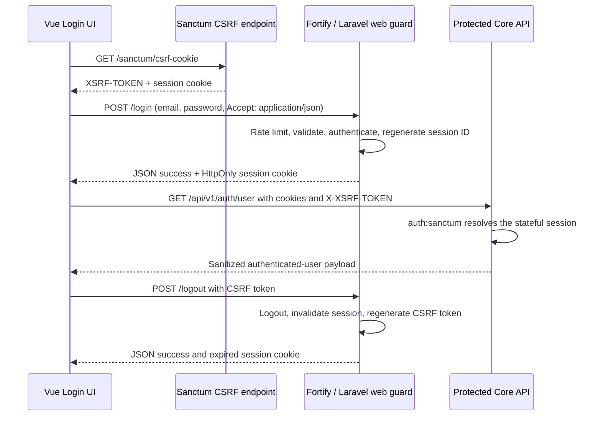

# Phase 4 Proposal: Authentication and Security

> **Status: APPROVED FOR IMPLEMENTATION.** The implementation request approves Fortify, Sanctum cookie-based SPA authentication, email verification, no registration/tokens/MFA/OAuth/roles, and preservation of the existing User model and stock migrations. Implementation decisions from that request supersede conflicting options below.

## 1. Objective and boundaries

Phase 4 will add a separately maintainable Core Authentication package for Laravel 12 and the existing Vue 3 + TypeScript workspace. It will provide login/logout, first-party SPA session authentication through Sanctum, password reset, email verification, session lifecycle controls, and authentication security protections.

It will not add user registration, user administration, roles/permissions, OAuth, account profiles, or business features unless separately approved. The future Roles & Permissions phase remains responsible for the `view-settings` and `manage-settings` abilities. Authentication establishes identity; it does not grant those abilities.

The implementation must preserve Phase 1 Foundation, the Phase 2 zero-table Core schema, Phase 3 Settings, Laravel's stock `App\Models\User`, and Laravel stock migrations.

## 2. Existing architecture inspection findings

### Host and packages

- The host is Laravel 12 (`laravel/framework` is locked at v12.71.0), with PHP 8.2+ required and PHP 8.4 as the documented target.
- Composer path packages use the repository's `packages/core/*` convention and Laravel provider auto-discovery. Foundation owns only the health/configuration behavior. Settings is a separate package and depends on Foundation for shared Core configuration.
- The npm workspace already has Vue 3, TypeScript, Vite, Axios, Vitest, and `@master-core/ui`. The UI package currently provides shared form controls, feedback components, and form styles.
- The root Vite app has no Vue Router dependency or shared application shell. Settings mounts its Vue app from a package Blade view; the Laravel welcome page remains the root route.
- `docs/architecture/overview.md` still describes Phase 1 as the only package and says authentication is excluded. That document is stale relative to the completed Phase 3 package. This proposal does not edit it; align it during the approved implementation/documentation stage.

### Current authentication status

| Area | Observed implementation |
|---|---|
| Authentication routes | No login, logout, password reset, or email verification routes are defined in application or Core package source. The welcome Blade view conditionally renders a login link only if a `login` route exists. |
| Laravel guard/provider | `config/auth.php` defaults to the `web` session guard and an Eloquent `users` provider. `AUTH_MODEL` defaults to `App\Models\User`, so the host can configure a different model/provider. The password broker is named `users` and uses `password_reset_tokens`, with 60-minute expiry and a 60-second token throttle. |
| User model | `App\Models\User` extends Laravel's `Authenticatable`, uses `HasFactory` and `Notifiable`, allows `name`, `email`, and `password`, hides `password` and `remember_token`, casts `email_verified_at` to datetime, and hashes assigned passwords. It does **not** implement `Illuminate\Contracts\Auth\MustVerifyEmail`. |
| Stock user migrations | The stock migration creates `users` with unique email, nullable `email_verified_at`, password, remember token, and timestamps. It also creates `password_reset_tokens` and `sessions`. These are host-owned and must remain unchanged. |
| Sanctum/Fortify | Neither `laravel/sanctum` nor `laravel/fortify` is present in `composer.json`, `composer.lock`, or `vendor`. `bootstrap/app.php` does not enable Sanctum's stateful API middleware. |
| Sessions and cookies | `config/session.php` defaults to the database driver, 120-minute inactivity lifetime, `http_only=true`, and `same_site=lax`. The `secure` flag and cookie domain are environment-driven. Test configuration uses array sessions. The actual `.env` values were not inspected, so the runtime driver, cookie security flag, domain, and mail delivery configuration are unknown. |
| CSRF and API routing | `bootstrap/app.php` uses Laravel's default middleware configuration and does not call `statefulApi()`. There is no host `routes/api.php`; package routes register APIs. The Settings API uses `api` plus generic `auth`, but there is no stateful SPA API configuration. Its admin page uses `auth` and `can:view-settings`. |
| Settings authorization | Settings also checks `view-settings` and `manage-settings`, but `AppServiceProvider` is empty and no Gate or role implementation defines these abilities. The Settings tests define Gates locally. Phase 4 must not substitute a broad authenticated-user grant for the future authorization phase. |
| CORS | `config/cors.php` is absent. The Settings mount is same-origin, so the initial login UI can remain same-origin without enabling cross-origin credential access. |
| Tests | PHPUnit covers basic host responses, Foundation routes/configuration, and Settings persistence/API behavior. Settings tests use `actingAs` and verify authentication/ability middleware, but there are no dedicated login, password reset, verification, session cookie, rate-limit, or email-flow tests. Frontend tests cover Settings and shared form components, not authentication. |

The root `composer.json` has `setup` and `post-create-project-cmd` scripts that can invoke application migrations. They must not be used as a Phase 4 verification shortcut; approved tests should continue to use the isolated SQLite `:memory:` configuration.

## 3. Recommended architecture

### Authentication package

Create `packages/core/auth` as `example/laravel-master-core-auth`, using the same local Composer path repository, package autoload, and provider auto-discovery conventions as Foundation and Settings. It will not define or persist a Core User model.

Recommended backend stack:

1. **Laravel Fortify** as the headless authentication backend for login throttling, password-reset workflow, email-verification workflow, and predictable framework responses. Disable Fortify's registration, two-factor, passkey, and profile-management features in Phase 4; none is in the approved scope. The package supplies its own Vue views and response customization. Fortify is designed to provide backend routes/controllers without imposing a frontend. [Laravel Fortify documentation](https://laravel.com/docs/12.x/fortify)
2. **Laravel Sanctum** for first-party SPA authentication using Laravel's session cookie and CSRF protection. Use cookie/session authentication for this same-origin Vue interface. Do not issue bearer or personal access tokens in Phase 4. Laravel explicitly advises against API tokens for a first-party SPA; Sanctum's SPA flow uses Laravel sessions and CSRF instead. [Laravel Sanctum documentation](https://laravel.com/docs/12.x/sanctum)
3. Use Laravel's configured auth guard, user provider, password broker, notification/mail services, session store, and cache-backed rate limiter. Package code should not query `App\Models\User` directly.

Fortify and Sanctum are not currently installed. Laravel 12's Sanctum 4.x line supports Laravel 12; Fortify 1.x supports Illuminate 12. Resolve compatible stable versions when implementation is approved, then update the Composer lockfile and add package integration tests. [Sanctum 4.x compatibility/release notes](https://github.com/laravel/sanctum/blob/4.x/CHANGELOG.md), [Fortify 1.x Composer requirements](https://github.com/laravel/fortify/blob/1.x/composer.json).

Fortify registers standard web authentication endpoints, while Sanctum supplies its CSRF-cookie endpoint and `auth:sanctum` guard. The Core package should add only package-specific JSON endpoints such as the current authenticated user and optional database-session inventory. It must avoid duplicate login/reset routes. Before enabling package routes in a consuming host, detect or document conflicts with any existing `login`, `logout`, password-reset, and email-verification routes.

### Proposed package layout

```text
packages/core/auth/
├── composer.json
├── README.md
├── config/
│   ├── authentication.php
│   └── fortify.php                 # host-overridable Fortify defaults
├── routes/
│   ├── api.php                     # authenticated user/session JSON endpoints
│   └── web.php                     # Vue page mounts and Fortify view callbacks
├── resources/
│   ├── js/
│   │   ├── auth.ts
│   │   ├── AuthApp.vue
│   │   └── types.ts
│   └── views/auth/                 # login, reset, verification page mounts
├── src/
│   ├── Http/Controllers/
│   ├── Http/Requests/
│   ├── Http/Resources/
│   └── Providers/AuthenticationServiceProvider.php
└── tests/
    ├── Feature/
    └── Unit/

packages/core/ui/src/components/
└── auth/                           # only shared auth controls used by real screens
```

The package may depend on Foundation for the shared API prefix/version and on `@master-core/ui` for reusable fields and buttons. It must not depend on Settings, User Management, or Roles & Permissions. Keep authentication data and rules in the Authentication package; keep host model selection in Laravel's configured provider.

## 4. User model compatibility decision

### Recommendation

Use the host application's configured Laravel authentication guard/provider as the identity source. Keep `App\Models\User` and the stock user migration in place. Do not create a Core User model, copy the `users` table, or hard-code `App\Models\User` in package services.

Fortify, Laravel's password broker, and Sanctum should resolve the user through configured guards/providers. The package accepts the framework's authenticatable user contract and uses framework services for login, reset, and current-user retrieval. That allows consuming hosts to select another compatible user model/provider through standard Laravel configuration.

### Email verification host contract

The current model already has `email_verified_at`, but it does not opt into Laravel's `MustVerifyEmail` contract. Laravel's `verified` middleware only enforces verification for models that implement that contract. The implementation proposal is to make the smallest host integration change: keep `App\Models\User` and its table unchanged, and add `MustVerifyEmail` to this existing model when Phase 4 verification is approved. No migration is needed. A consumer with a custom model must implement the same contract or explicitly disable required verification for that guard. [Laravel email verification requirements](https://laravel.com/docs/12.x/verification)

This model change is an implementation-stage host integration, not a second Core User model. It is listed as a required approval item because it edits an existing host file even though it preserves its class, table, and stock migration.

### Future package compatibility

- **User Management** owns account creation, account state, and any future additive user-profile schema. Authentication remains a consumer of the configured auth provider.
- **Roles & Permissions** must attach roles/policies to the configured authenticatable model, or document an explicit host adapter. It must not assume every host class is `App\Models\User`.
- **Custom host users** must supply Laravel's authenticatable/password-reset contracts, notification delivery (`Notifiable` or an equivalent notification route), and the identifier/password fields expected by the configured provider. Email verification additionally requires `MustVerifyEmail` when enabled.
- **Sanctum SPA cookies** do not require `HasApiTokens`. Adding that trait and Sanctum's `personal_access_tokens` table is outside Phase 4 unless external bearer tokens/device tokens are separately approved.

### Trade-offs

- Reusing the host provider avoids a duplicate identity table and supports Laravel applications with custom user classes.
- Email verification is a host-model opt-in; the Core package cannot safely mutate arbitrary models. This repository needs the small explicit interface addition described above.
- Fortify route names are conventional and may collide in a host that already owns authentication routes. The package needs configurable route registration/prefix behavior and an installation check.
- A future roles package must not confuse authentication with authorization. Successful login does not imply access to Settings or other protected modules.

## 5. Database ownership and proposed schema

### Phase 4 required tables

**No new Core-owned tables are proposed.** Reuse the existing Laravel stock tables and columns:

| Existing stock asset | Phase 4 use | Ownership and treatment |
|---|---|---|
| `users.email`, `users.password`, `users.remember_token`, `users.email_verified_at` | Credentials, persistent-login token, and email-verification state | Host/Laravel-owned. Preserve existing schema and model identity. |
| `password_reset_tokens` | Laravel password-broker tokens | Already defined by the stock migration; preserve unchanged. |
| `sessions` | Database-backed session storage and, when enabled, active-session list/revoke operations | Already defined by the stock migration; preserve unchanged. `user_id` is indexed but has no declared foreign key. |
| `cache`, `cache_locks` | Cache-backed throttling when the host selects the database cache store | Laravel stock tables; preserve unchanged. |

No Foundation or Authentication migration is needed for cookie-based SPA auth, login throttling, password resets, or email verification. Sanctum's `personal_access_tokens` migration is **not** part of the proposed first-party SPA scope because token issuance is excluded. Do not run `install:api`, publish migrations, or use an install script that migrates the configured host database without explicit approval.

### Future optional tables

- `personal_access_tokens` from Sanctum, only if separately approved external/mobile bearer-token issuance is needed. Sanctum token use would also require a host-model integration contract and token expiration/revocation policy.
- Authentication audit/event tables belong to the future Audit Logs module; do not add them here.
- Roles, permissions, user profiles, MFA factors, or recovery-code tables are outside Phase 4. Fortify's two-factor/passkey features remain disabled.

### Migration and rollback policy

Phase 4 has no new migration or rollback. Preserve stock migrations and verify session/password reset/verification flows only on the isolated SQLite test database. A future approved token table must be documented and package-owned, with explicit rollback/data-loss behavior and MySQL verification on an isolated database.

## 6. Authentication flows

### First-party login, request authentication, and logout



Use same-origin requests by default. Do not put session IDs, passwords, or bearer tokens in local storage, URLs, logs, or application settings. Protected Settings API routes should move from generic `auth` to `auth:sanctum` after Sanctum is installed and stateful API handling is configured. The `can:view-settings` and `can:manage-settings` checks remain in place for the future authorization phase.

### Password reset

1. The user submits an email address to the password-reset link endpoint.
2. Respond with the same public success message whether or not the address belongs to an account; send mail only for a valid account.
3. Laravel's password broker stores a hashed, expiring, throttled reset token in the stock `password_reset_tokens` table and sends a signed/reset link through the configured mailer.
4. The Vue reset page submits token, email, new password, and confirmation to the reset endpoint.
5. On success, hash the password using Laravel's configured hasher, invalidate the reset token, rotate the remember token, and require a fresh login. Revoke or invalidate old authenticated sessions as supported by the configured session guard/store.

Use Laravel's password broker rather than a Core token table or custom token generator. [Laravel password broker documentation](https://laravel.com/docs/12.x/passwords)

### Email verification

1. An authenticated, unverified user requests a verification notification; enforce a resend limiter.
2. Laravel sends a signed URL containing the user identifier and email hash.
3. The signed verification route checks authentication, signature, route/user match, expiration, and throttling before marking `email_verified_at` and dispatching the verified event.
4. Redirect to a named host destination or return a predictable JSON response; never trust a client-provided `verified` flag.
5. Apply `verified` middleware only where the host's approved verification policy requires it.

No account-registration flow is proposed. Existing users may be provisioned by the host or future User Management package.

### Session management

- Regenerate the session ID on successful login; invalidate the session and regenerate its CSRF token on logout.
- The approved package provides `GET /api/v1/auth/sessions` and `DELETE /api/v1/auth/sessions/{id}` for listing/revoking other sessions **only when** `SESSION_DRIVER=database`. Queries/deletes are scoped to the authenticated user's key, session payloads/raw IDs are never returned, and the current session cannot be revoked through inventory.
- A host using file, Redis, or another session driver receives a documented `501` capability response from inventory endpoints. Login/logout remain available through the selected Laravel session store.
- Successful reset rotates the remember token and removes the user's rows from the stock database `sessions` table when database sessions are configured.

## 7. Proposed API and route plan

The web login/reset/verification routes stay on Laravel's web middleware so session and CSRF behavior are consistent. They accept JSON for the same-origin Vue client and browser redirects where appropriate. Versioned JSON endpoints use the configurable Authentication API prefix, defaulting to `api/v1/auth`. Fortify route names and JSON responses were verified against the resolved package version during implementation.

| Method and path | Access | Purpose |
|---|---|---|
| `GET /sanctum/csrf-cookie` | Public web route | Initialize XSRF/session cookies before login or other state-changing requests. |
| `GET /login` | Guest web route | Serve the Vue login page. |
| `POST /login` | Guest + CSRF + login limiter | Authenticate against the configured guard/provider; respond with JSON for SPA requests. |
| `POST /logout` | Authenticated + CSRF | Invalidate the current session. |
| `GET /forgot-password` | Guest web route | Serve the password-reset request page. |
| `POST /forgot-password` | Guest + CSRF + reset limiter | Request a generic-response reset email using Laravel's password broker. |
| `GET /reset-password/{token}` | Guest web route | Serve the reset form with token/email context. |
| `POST /reset-password` | Guest + CSRF + validation | Reset the password through the configured broker. |
| `GET /email/verify` | Authenticated | Show the verification-required page. |
| `GET /email/verify/{id}/{hash}` | Authenticated + signed + throttled | Verify the authenticated user's email address. |
| `POST /email/verification-notification` | Authenticated + CSRF + throttle | Resend verification mail. |
| `GET /api/v1/auth/user` | `auth:sanctum` | Return only an allowlisted identity payload (ID, display name, email, verification state); never return password/hash/token fields. |
| `GET /api/v1/auth/sessions` | `auth:sanctum`, database session driver | List only the current user's safe session metadata. |
| `DELETE /api/v1/auth/sessions/{id}` | `auth:sanctum`, database session driver | Revoke one of the current user's other sessions using its opaque hash reference. |

The API path defaults to `api/v1/auth` and is configurable through `MASTER_CORE_AUTH_API_PREFIX`. Fortify's conventional web routes are not moved under `/api` solely for appearance.

## 8. Middleware, sessions, and cookie configuration

- In the Laravel 12 host integration, enable Sanctum's `statefulApi()` middleware in `bootstrap/app.php` and configure the stateful frontend domains. This is a host bootstrap edit; package auto-discovery alone does not make API routes stateful.
- Protect Settings and future package APIs with `auth:sanctum`, then perform authorization with host policies/Gates. Do not give users roles/abilities in this phase.
- Leave CSRF enabled for session-authenticated POST/PUT/PATCH/DELETE requests. The login page first requests the CSRF-cookie route; Axios sends credentials and the decoded XSRF value using the supported header behavior.
- Keep session cookies HttpOnly and SameSite Lax for the current same-origin UI. Require HTTPS and `Secure` cookies in production. Do not weaken SameSite or enable wildcard credentialed CORS.
- If a consuming SPA later lives on a sibling subdomain, require an explicit configuration review for exact `SANCTUM_STATEFUL_DOMAINS`, session cookie domain, HTTPS/Secure/SameSite settings, and credentialed CORS allowed origins.
- Return JSON `401`/`403` for API authentication/authorization failures instead of redirecting API clients to a missing named route. Return `419` consistently for stale CSRF/session requests.
- Do not expose session payloads, remember tokens, password hashes, reset tokens, IP/user-agent data in general user JSON, or internal provider configuration.

## 9. Login throttling and password/security protections

- Use Fortify's login throttle with five attempts per normalized identifier/IP per minute and a separate fifty-attempt per-IP ceiling to slow credential spraying without permanently locking a victim's account.
- Use Laravel's configured cache limiter, never a database table of failed logins. Document the host cache-store dependency. This app defaults its cache configuration to the database store, while PHPUnit forces the array store.
- Keep failed-login and password-reset messages generic so account existence is not exposed. Avoid logging submitted credentials, reset links, verification hashes, cookies, or session IDs.
- Validate login identifier and password server-side. Password resets require 12 characters, mixed case, numbers, and confirmation; Laravel's configured hasher stores the new secret. The implementation does not call a third-party compromised-password service.
- Apply request-size limits, HTTPS in production, host validation/proxy configuration, secure mail link generation, signed URL expiry, and rate limits to login, reset-link requests, reset submissions, verification resends, and session revocation.
- Do not add custom MFA, passkeys, registration, OAuth, or personal token issuance in this phase. Fortify's corresponding features remain disabled until separately approved.

## 10. Vue 3 + TypeScript login UI

- Add a package-owned Blade mount for `/login`, password-reset and verification states, and a small authenticated `/app` account-security shell. Vue Router is approved and protects guest/auth routes without adding unrelated dashboard or CRUD functionality.
- Reuse `CoreField`, `CoreTextInput`, and `CoreButton`; add a shared password input with accessible show/hide control and an auth page shell only if both Settings/other modules can use it.
- Follow documented page typography/spacing, standard input height/outline, visible labels, accessible help/errors, responsive layout, disabled/loading state, toast/alert feedback, and keyboard focus behavior.
- Login UI submits only to the backend, never decides authorization. Display generic credential failures and server validation errors. Provide clear links for password reset and verification resend where relevant.
- Reuse Axios and the existing CSRF meta/cookie contract. Do not store passwords/tokens in browser storage. On `401`, direct users to login; on `419`, refresh CSRF/session and show a recoverable message without retrying a password submission automatically.

## 11. Testing strategy

### Backend

- Package discovery, route cache, configurable API prefix/version, no collision with existing host routes, and host auth provider/model resolution.
- Login success/failure, JSON `401`, session ID regeneration, remember-me policy if enabled, logout invalidation/CSRF rotation, and login rate-limit boundary.
- CSRF/stateful Sanctum feature tests for cookie-authenticated SPA requests; prove protected Settings routes return unauthenticated `401`, preserve `can` denial as `403`, and succeed only with a host-defined Gate.
- Password-reset generic response/account non-enumeration, valid/expired/invalid token, throttle behavior, password confirmation/rules/hashing, remember-token rotation, and notification mail assertions.
- Email-verification valid signed URL, wrong user/email hash, expired/invalid signature, resend throttle, event dispatch, and model contract behavior.
- Session list/revoke ownership isolation and behavior for database vs unsupported session stores. Never return session payloads.
- Model-adapter tests with the repository's `App\Models\User` and a test custom authenticatable provider/model. Confirm the package does not import the concrete host model.
- Regression checks for Foundation health and Settings public/private authorization. Use SQLite `:memory:`, fake mail/notifications, fake cache, and deterministic limiter state. Do not run `artisan migrate` against the configured application database.

### Frontend

- `vue-tsc`, Vitest with mocked Axios, and Vite production build.
- Login field labels/validation, password visibility accessibility, disabled/loading and generic errors, CSRF bootstrap, successful redirect/response handling, password-reset request and submission states, verification resend/success states, and unauthenticated/expired-session handling.
- Test the shared form components in their Settings consumer and keep responsive layout checks distinct from build/unit-test claims. Manual browser acceptance should verify the login, logout, reset, and verification mail flow after implementation.

## 12. Dependencies and host integration

Proposed Composer dependencies:

- `laravel/sanctum` 4.x for Sanctum's SPA stateful API guard and CSRF-cookie route.
- `laravel/fortify` 1.x for headless login, throttling, password reset, and email-verification flow.
- `example/laravel-master-core-foundation` `dev-main` only for shared Core API prefix/version configuration.
- Existing Laravel 12 services for auth, password broker, notifications, mail, sessions, hashing, cache/rate limiting, and validation.

Proposed npm integration:

- Add `packages/core/auth` as a workspace package and reuse Vue 3, TypeScript, Axios, Vite, Vitest, and `@master-core/ui`; add Vue Router as approved by the implementation request.

Host-specific implementation touchpoints, all requiring review when Phase 4 is approved:

1. Add local Composer path repository/requirement and npm workspace entry.
2. Add one Sanctum `statefulApi()` call and host stateful domain configuration.
3. Add `MustVerifyEmail` to the existing host `App\Models\User` if verification enforcement is approved. Preserve its class and stock table/migration.
4. Change Settings private API middleware from generic `auth` to `auth:sanctum` after integration, while leaving its two ability checks intact.
5. Configure the mail transport and production cookie/security environment values in each consuming host. The current environment values were not inspected.

No dependency installation or host modification is authorized by this proposal.

## 13. Implemented sequence

1. **Approved decisions:** Fortify + Sanctum SPA sessions; no registration, personal tokens, MFA/passkeys, OAuth, or roles; add `MustVerifyEmail` to the existing host User; email verification is available but not a global access gate; database session inventory is conditional; current-user JSON is allowlisted.
2. **Package scaffold:** add Composer/npm workspaces, provider, configs, package docs, route collision handling, and host integration instructions. Keep Foundation unchanged.
3. **Authentication backend:** wire Fortify login/logout, JSON response handling, login limiter, guest/auth middleware, `auth:sanctum`, current-user response, and configurable URL prefix.
4. **Reset and verification:** use the stock password broker/table and stock `email_verified_at`; add signed verification/resend logic and minimal MustVerifyEmail integration without model/table replacement.
5. **Session lifecycle:** secure session regeneration/logout; implement database-driver session inventory/revocation only if that scope is approved.
6. **Vue UI:** add login, reset, and verification pages using Core UI, Axios CSRF, responsive states, and existing shared design standards. No unrelated dashboard or user-management pages.
7. **Tests:** implement isolated backend and frontend tests by feature; execute only against SQLite `:memory:`/fakes until a separate MySQL test database is explicitly available.
8. **Docs and verification:** update package/host installation docs and architecture overview, run package discovery/route listing, tests, typecheck/build, and manual browser/email acceptance. Do not run host database migrations without separate explicit confirmation.

## 14. Risks and compatibility concerns

- **Existing Settings API:** its private routes use `api` + generic `auth`, but Sanctum stateful API middleware is absent. The browser-session path is not configured; add Sanctum stateful handling and use `auth:sanctum` during integration. The existing route ability checks remain mandatory.
- **User verification contract:** the stock model has the timestamp but does not implement `MustVerifyEmail`. Signed verification cannot be enforced with Laravel's standard `verified` middleware until the existing model opts in or a host adapter is provided.
- **Route conflicts:** third-party host apps may already own Fortify or login routes. Route registration must be configurable and collision-checked; do not overwrite host routes or published configs.
- **Session driver variation:** the current config defaults to database sessions, but an uninspected `.env` may override this. Active-session inventory must be conditional on the effective driver.
- **Mail not verified:** password reset and verification rely on host mail configuration. This inspection did not inspect `.env` values or send messages.
- **Cookie/CORS deployment:** current UI is same-origin and no CORS config exists. Separate subdomain deployment needs explicit domain, `Secure`, SameSite, and credentialed CORS settings.
- **Role boundaries:** Authentication alone must not grant Settings access. The future roles package or consuming host must define `view-settings` and `manage-settings`.
- **No user provisioning:** registration is intentionally excluded, so an existing host or future User Management package must create accounts.
- **Dependency scope:** Fortify brings headless features and dependencies beyond this phase; disable registration, passkeys, two-factor, and profile routes and confirm the locked compatible versions at implementation time.

## 15. Acceptance criteria

- Authentication is a separately maintained Composer package with Laravel provider auto-discovery and no dependency on Settings persistence.
- Existing Foundation, Settings, stock migrations, and the identity of `App\Models\User` are preserved; no duplicate Core user table/model is introduced.
- First-party Vue requests authenticate through Sanctum's session-cookie flow with CSRF protection; no browser bearer tokens are issued or stored.
- Login/logout, password reset, email verification, session lifecycle, and rate limits use Laravel-supported services with generic failure handling and validated inputs.
- Settings routes keep host authorization checks and deny users who are authenticated but not authorized.
- API responses are safe and predictable, and API auth failures return JSON instead of missing-route redirects.
- Login/reset/verification UI follows the Global UI and CRUD Standards and reuses Core UI components.
- Backend and frontend security flows have deterministic test coverage; the test suite runs against isolated SQLite `:memory:` without touching configured application data.
- The package documents required User model contracts, host stateful-domain/cookie/mail setup, route conflicts, and session-driver limitations.
- No registration, roles/permissions, OAuth, MFA, passkeys, personal access tokens, or unrelated modules are implemented without separate approval.

## 16. Approved implementation decisions

1. Fortify + Sanctum first-party session-cookie authentication is approved.
2. Preserve the host model and migrations; add only `MustVerifyEmail` to the current `App\Models\User`.
3. Do not globally block unverified users; host routes may apply `verified` selectively.
4. List/revoke other sessions only with the database driver; prevent current-session revocation.
5. Registration, bearer tokens, MFA/passkeys, OAuth, Roles & Permissions, and unrelated modules remain excluded.

The implementation outcome and actual checks are recorded in [Phase 4 completion](phase4-auth-security-completion.md).

## References

- [Laravel 12 Authentication](https://laravel.com/docs/12.x/authentication)
- [Laravel 12 Sanctum](https://laravel.com/docs/12.x/sanctum)
- [Laravel 12 Fortify](https://laravel.com/docs/12.x/fortify)
- [Laravel 12 Password Reset](https://laravel.com/docs/12.x/passwords)
- [Laravel 12 Email Verification](https://laravel.com/docs/12.x/verification)
- [Sanctum 4.x release notes](https://github.com/laravel/sanctum/blob/4.x/CHANGELOG.md)
- [Fortify 1.x Composer requirements](https://github.com/laravel/fortify/blob/1.x/composer.json)
