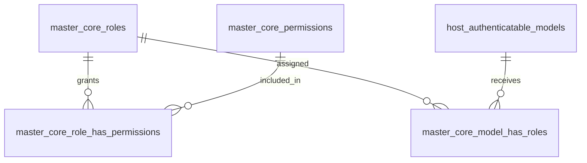

# Phase 6 Proposal: Roles & Permissions

> **Status: APPROVED FOR IMPLEMENTATION.** The user approved the 10 decisions recorded in the Phase 6 approval checklist on 2026-11-15. Implementation and verification details are tracked in the [Phase 6 completion report](phase6-roles-permissions-completion.md).

## 1. Goal and boundaries

Provide a separately maintainable Core module for assigning multiple roles to host users, assigning permissions to roles, and resolving those permissions through Laravel authorization. The module will integrate with the existing Authentication, User Management, and Settings packages. Laravel Gates and Policies remain the application authorization interface; frontend checks only control visibility and navigation.

The proposal does not add a second user model/table, direct user-permission grants, teams/tenants, OAuth, or business-specific permissions. It does not auto-create an administrator or grant a permission to any user. Audit history remains a future Audit Logs responsibility.

## 2. Repository inspection findings

### Current packages and host

- The Laravel 12 host contains separately discovered Foundation, Settings, Authentication, and User Management Composer packages. The Vue 3/TypeScript workspace has `@master-core/ui`, `@master-core/auth`, and `@master-core/user-management` packages. Composer uses local `example/` path packages.
- Foundation provides API prefix/version conventions and remains database-independent. Settings owns `master_core_settings`. User Management operates on the configured host Eloquent model and owns only its additive `is_active`/`deleted_at` migration. Neither Foundation nor this proposal should take ownership of those tables/columns.
- The host `App\Models\User` extends Laravel's authenticatable model. User Management adds `SoftDeletes` and the active-state cast; the Laravel stock user migration, unique email index, and host identity model remain in place.
- Authentication uses Fortify for session flows and Sanctum for same-origin API authentication. `bootstrap/app.php` enables stateful API handling. Core Authentication exposes the current user and session endpoints; User Management extends the existing authenticated Vue router.

### Existing authorization

- There are **no persisted roles or permissions**, no Core role/permission models, and no application-defined Gate registry or policy classes found in `app/` or `bootstrap/`.
- Settings uses Laravel's native `auth:sanctum` plus `can:view-settings` / `can:manage-settings` middleware. The public Settings endpoint is separate and explicitly allowlisted.
- User Management checks host Gates in its controller and returns a capabilities payload for the UI. It has configured ability names and a fail-closed `UserManagementSafetyPolicy`; it does not create or grant abilities.
- Authentication protects its private routes with `auth:sanctum`. Its Vue router currently checks only whether the user is authenticated; it has no permission-aware route or navigation layer.
- Current automated tests define Gates locally per test. They cover authorization denial/allowance for Settings and User Management, but there is no role/permission persistence or permission-resolution implementation.
- No `spatie/laravel-permission` runtime dependency is present. No dependency was installed or changed while preparing this proposal.

## 3. Recommended authorization approach

### Keep Laravel Gate and Policy as the public contract

Use Laravel Gates/Policies for route middleware, controllers, services, and model-specific decisions. Add a package-owned RBAC resolver which answers known permission abilities from role assignments, then expose it to Laravel Gate. Settings can keep using its existing `can:` middleware and User Management can keep its authorization boundary while the host transitions to the new permission catalog. Policy-specific checks (ownership, record state, account safety) remain in host/package policies and are not replaced by a role check.

The RBAC resolver should only resolve registered ability names. Unknown abilities return `null` from the Gate integration so normal host-defined Gates and Policies continue to work. Two Gate modes need an explicit rollout decision:

- **Compatibility (recommended initial mode):** a positive Core role grant allows the registered ability; no Core grant returns `null`, allowing the pre-existing host Gate/Policy to decide. This preserves host authorization behavior, but a legacy host Gate may continue allowing an ability after its Core role grant is removed.
- **Strict RBAC:** for a registered ability, return an explicit allow or deny based only on Core role assignments (plus the protected Super Admin rule). Host Gates cannot broaden a registered ability. Switch only after the host has reviewed and provisioned all required role grants.

Neither mode grants a permission automatically. The UI/API must clearly identify the active mode. Unknown or unregistered abilities continue to normal host Gate/Policy handling in either mode. Any Super Admin bypass is limited to registered abilities and applies only to an active, non-trashed authenticated user.

### Library evaluation

| Approach | Benefits | Costs and fit for this repository |
|---|---|---|
| Laravel Gates/Policies alone | Native, already used by Settings and User Management; supports contextual policy decisions and no new runtime dependency. | Does not provide persisted roles, role/permission assignment, or a permissions management catalog. Reimplementing all of those as ad hoc Gates would spread authorization logic across host apps. |
| Spatie Laravel Permission | Established RBAC library integrated with Laravel Gate, supports multiple roles and permissions, and documents cache invalidation through its assignment APIs. Its current version documentation lists Laravel 12 support; v7/v8 require PHP 8.3+, while v6 supports Laravel 12 with PHP 8.0–8.5. | Its installation expects a published vendor migration/configuration and a `HasRoles` trait on the host User model. The standard schema includes direct model-permission support and optional teams. Those defaults exceed the minimal Core scope and complicate Core-owned migration lifecycle and host-model neutrality. Pinning a supported major and maintaining host integration would also become a compatibility commitment. |
| Focused Core RBAC package using native Gate/Policy | Keeps Core-owned migrations, table names, catalog, package UI, and host-model integration under this repository's conventions. Can support multiple roles per user while omitting unused direct user grants and teams. | Core maintainers own security-sensitive permission resolution, cache behavior, migration compatibility, and extensive regression tests. This choice must be approved explicitly; it is not a claim that a custom engine has fewer risks. |

**Recommendation:** build a focused `core/roles-permissions` package around Laravel Gates/Policies, with a deliberately small role-to-permission resolver and no custom replacement for Laravel's policy system. The explicit constraints of Core-owned migrations, no host User replacement, a controlled permission catalog, and no direct user grants make the smaller domain schema a better fit than installing the full Spatie surface. Keep the option to adopt Spatie later if Core needs teams, direct grants, or broader ecosystem interoperability. Before implementation, review the chosen Gate integration ordering against Laravel 12 and test it with host-defined Gates.

Spatie sources reviewed: [compatibility and User model prerequisites](https://github.com/spatie/laravel-permission/blob/main/docs/prerequisites.md), [installation and migration publishing](https://github.com/spatie/laravel-permission/blob/main/docs/installation-laravel.md), and [cache behavior](https://spatie.be/docs/laravel-permission/v8/advanced-usage/cache). Package version compatibility changes over time and must be rechecked before a future dependency decision.

## 4. Package and host integration plan

Proposed package: `packages/core/roles-permissions/`, Composer name `example/laravel-master-core-roles-permissions`, npm workspace `@master-core/roles-permissions`.

```text
packages/core/roles-permissions/
├── composer.json
├── package.json
├── README.md
├── config/roles-permissions.php
├── database/migrations/                 # four package-owned tables only
├── routes/api.php
├── src/
│   ├── Contracts/                       # permission registry / resolver boundaries
│   ├── Events/                          # audit-ready role/permission changes
│   ├── Http/Controllers/Requests/Resources/
│   ├── Middleware/                      # optional permission middleware alias
│   ├── Models/                          # Core Role and Permission records
│   ├── Policies/                        # Core record-level safety rules
│   ├── Providers/RolesPermissionsServiceProvider.php
│   └── Support/                         # Gate bridge, resolver, cache invalidation
├── resources/js/
│   ├── api.ts
│   ├── routes.ts                        # records composed into the Auth router
│   ├── components/
│   └── pages/                           # roles, permissions, role/user assignment
└── tests/
    ├── Feature/
    └── Unit/
```

Foundation remains independent. The package depends on Laravel and the Core Auth/User Management integration contracts (and Foundation only for the shared API prefix/version convention). The npm package depends on Vue 3, TypeScript, the existing `@master-core/ui` and `@master-core/auth` packages, and uses the current authenticated router. It must not build a second design system or mount a second application shell.

Do not replace or require a Core User model. Resolve the host authenticatable Eloquent model using the configured auth provider, as User Management does. Use a morph assignment keyed by model type and stringified model identifier so a host can use an integer, UUID, or ULID key. This preserves the existing `App\Models\User` and stock migrations. The supported host must use Laravel's Gate-compatible `Authorizable` authenticatable model; non-Eloquent auth providers require a future adapter.

## 5. Minimum database schema

Four tables are required for role-based grants: roles, permissions, role-permission links, and host-model role assignments. There is no direct user-permission table: all grants flow through roles. The package owns all four migrations. There are no foreign keys to host user tables because host models/tables/identifier types vary.

### `master_core_roles`

| Attribute | Proposal |
|---|---|
| Purpose | Named groups of permissions assigned to one or more host authenticatable models. |
| Columns | `id BIGINT UNSIGNED` auto-increment; `name VARCHAR(120)`; immutable `role_key VARCHAR(64)`; `guard_name VARCHAR(64)`; `is_system BOOLEAN NOT NULL DEFAULT false`; `created_at TIMESTAMP NULL`; `updated_at TIMESTAMP NULL`. |
| Primary key | `id`. |
| Foreign keys | None. |
| Unique constraints | `(guard_name, name)` and `(guard_name, role_key)`. Enforce normalized role names in validation; database collation differences are covered in migration tests. |
| Indexes | Both unique indexes above; index on `(guard_name, is_system)` for catalog and safety checks. |
| Nullable | Timestamps may be null as Laravel permits; name and guard are required. |
| Timestamps | Laravel `created_at` / `updated_at`. |
| Soft-delete policy | No soft deletes. System/super-admin roles are protected; ordinary role deletion requires it to be unassigned and confirmed. |
| Relationship behavior | Belongs to many permissions; morph-to-many assignments for host authenticatable models. Deletion is restricted while assignment/pivot rows remain. |

### `master_core_permissions`

| Attribute | Proposal |
|---|---|
| Purpose | Canonical named authorization abilities and optional display grouping. |
| Columns | `id BIGINT UNSIGNED` auto-increment; `name VARCHAR(191)`; `guard_name VARCHAR(64)`; `group_name VARCHAR(100)`; `description VARCHAR(255) NULL`; `is_system BOOLEAN NOT NULL DEFAULT false`; `created_at TIMESTAMP NULL`; `updated_at TIMESTAMP NULL`. |
| Primary key | `id`. |
| Foreign keys | None. |
| Unique constraints | `(guard_name, name)`. Ability identifiers are lower-case dotted or hyphenated names and are normalized/validated by the service. |
| Indexes | Unique index above; index on `(group_name, name)` for grouped permission catalog filtering. |
| Nullable | `description`, timestamps. `group_name` is required; use a defined `other` group for host extensions. |
| Timestamps | Laravel `created_at` / `updated_at`. |
| Soft-delete policy | No soft deletes. Core catalog permissions are `is_system=true` and cannot be renamed/deleted through normal CRUD. Custom permissions can only be deleted after they are detached from all roles and explicitly confirmed. |
| Relationship behavior | Belongs to many roles. Deletion is restricted while role links remain; the service must perform an explicit authorized detach before deletion if allowed. |

### `master_core_role_has_permissions`

| Attribute | Proposal |
|---|---|
| Purpose | Many-to-many mapping of roles to permissions. |
| Columns | `role_id BIGINT UNSIGNED`; `permission_id BIGINT UNSIGNED`. No pivot timestamps; assignment history is outside this module. |
| Primary key | Composite `(role_id, permission_id)`. |
| Foreign keys | `role_id` → `master_core_roles.id`; `permission_id` → `master_core_permissions.id`; both `ON DELETE RESTRICT`. |
| Unique constraints | Composite primary key prevents duplicate assignment. |
| Indexes | Composite primary key plus reverse index `(permission_id, role_id)` for permission impact checks. |
| Nullable | None. |
| Timestamps | None. |
| Soft-delete policy | Not applicable. |
| Relationship behavior | Both referenced entities must exist. Authorized role-permission sync is atomic and rejects unknown, reserved, or wrong-guard permission IDs. |

### `master_core_model_has_roles`

| Attribute | Proposal |
|---|---|
| Purpose | Assign one or more roles to a host authenticatable Eloquent model, including the configured user model. |
| Columns | `role_id BIGINT UNSIGNED`; `model_type VARCHAR(191)`; `model_id VARCHAR(191)` storing the host key as a string. |
| Primary key | Composite `(role_id, model_type, model_id)`. |
| Foreign keys | `role_id` → `master_core_roles.id` with `ON DELETE RESTRICT`. No host model FK by design. |
| Unique constraints | Composite primary key prevents duplicate role assignment. |
| Indexes | `(model_type, model_id)` for user/model lookup; the composite primary key supports role-first lookup. |
| Nullable | None. |
| Timestamps | None; assignment event history belongs to Audit Logs. |
| Soft-delete policy | Not applicable. On User Management soft delete, retain assignment rows so restoring the same host record restores its authorization state; inactive/trashed users must still be denied by active-user enforcement. Permanent user deletion may leave an orphan morph row; provide a guarded cleanup command/report after deletion, never broad automatic cleanup. |
| Relationship behavior | A polymorphic association intentionally has no FK to host tables. Role deletion is restricted while assignments exist. Model type must be allow-listed to configured authenticatable model classes. |

### Mermaid ER diagram



`host_authenticatable_models` is a polymorphic reference to the configured host model, not a Core table. It is shown to make the relationship clear; the database cannot enforce a foreign key to multiple possible host tables.

### Migration order and rollback

1. Create `master_core_roles`.
2. Create `master_core_permissions`.
3. Create `master_core_role_has_permissions` after both parents.
4. Create `master_core_model_has_roles` after roles.

Each migration checks for table-name collisions and must not alter host, Settings, Auth, or User Management tables. `down()` must refuse to drop non-empty role/permission/assignment tables unless an explicit reviewed export/reset procedure has preserved the data. Rollback order is reverse dependency order. Never run migrations against the configured host database as part of tests or Phase 6 verification without separate explicit approval.

### SQLite and MySQL compatibility

Use Laravel Schema Builder, integer IDs for Core-owned entities, portable booleans/timestamps/varchars, and ordinary composite indexes. Avoid JSON, partial indexes, engine-specific upsert behavior, and nullable unique tricks. `model_id` as `VARCHAR(191)` allows string representations of integer, UUID, and ULID keys. Verify composite index sizes on MySQL 8 `utf8mb4`, and run SQLite in-memory tests with foreign keys enabled. The host identifier conversion and morph class must be integration-tested for each supported model type.

## 6. Initial permission catalog and safe provisioning

The following Core abilities should be registered as system permissions. Registration defines what the application can check; it never grants the permission to a user or role. A code-owned permission registry (Core package definitions plus explicit host-module extensions) is the authority for executable ability names. The table is a persisted, assignable catalog, not a way to invent an executable Gate from arbitrary request input.

| Group | Permission identifiers |
|---|---|
| Settings | `view-settings`, `manage-settings` |
| User Management | `view-users`, `create-users`, `edit-users`, `delete-users`, `restore-users`, `manage-user-status`, `manage-user-roles` |
| Roles & Permissions | `view-roles`, `create-roles`, `edit-roles`, `delete-roles`, `view-permissions`, `manage-permissions` |
| Additional current User Management operations | `force-delete-users`, `reset-user-passwords`, `resend-user-verification` (retain only if the host needs distinct authorization for these actions). |

**Phase 5 compatibility contract:** current User Management checks `update-users` for edits and also checks the optional broad `manage-users` Gate. Preserve those contracts in Compatibility mode. Map `update-users` to the canonical `edit-users` permission for role resolution while continuing to evaluate the host's existing `update-users` Gate when no Core grant decides the result. `delete-users` means soft-delete/trash; `force-delete-users` remains a separate, more sensitive ability. Keep `reset-user-passwords` and `resend-user-verification` as separately configurable operations. `manage-user-roles` is new and must not be inferred from general user edit/delete rights. In Strict mode, the package disables User Management's broad `manage-users` fallback. Hosts must document their Gate/Policy review and provision every required Core grant; explicit host gates can still deny a registered ability, but cannot broaden it.

Permissions are provisioned by the explicit, idempotent `master-core:permissions:sync` Artisan command. Its default mode is a dry run; `--apply` materializes registered rows. It may insert/update registry-owned labels/group metadata for known identifiers but must never delete unknown permissions or grant any permission to a role. Custom host permissions are registered deliberately through a code-level provider/config extension and then materialized by the sync command. The HTTP create endpoint may only materialize an already-registered definition; it cannot make a new arbitrary ability executable. Permission names remain immutable in the UI; description/group metadata may be edited if the registry permits. No permission should be auto-granted during package discovery, migration, cache warmup, or login.

Direct user permissions are not proposed. If a future workflow proves that a user-specific exception is necessary, it requires a separate schema and authorization review rather than an implicit bypass.

## 7. Role and Permission behavior

- Support multiple roles per host user and multiple permissions per role. Keep role assignment and permission assignment separate operations with explicit authorization and atomic validation.
- Role names and permission names are unique per Laravel guard. The API/UI must display a guard and prevent assignments across guards.
- Permission group is a display/filter field, not a security boundary. Search, group filters, and sorting are server-side and allow-listed.
- System permission identifiers cannot be renamed/deleted. System roles cannot be renamed/deleted or have their reserved flags changed by ordinary CRUD.
- A role may be deleted only if it is not assigned to any host model and policy confirms deletion. A permission may be deleted only if it is not referenced by a role. No cascade should silently remove active authorization assignments.
- Do not add bulk role deletion or bulk permission deletion in the first release. Bulk assignment may be considered for role-permission links only after transactional/authorization behavior is tested.

## 8. Super Admin and initial access

Recommend one reserved system `Core Super Admin` role per guard, identified by immutable `role_key='core-super-admin'` and protected by the unique `(guard_name, role_key)` constraint. This avoids relying on an unconstrained boolean flag that could accidentally identify multiple Super Admin roles. The role's bypass applies only to registered Core permissions, and never skips User Management's active/not-trashed account check or contextual policies/safety rules. Ordinary UI requests cannot create, flag, delete, rename, or assign this role.

Provisioning must be an explicit console-only operation against an existing host user selected by ID/email. The command should display the target identity, require an interactive typed confirmation (no silent default, seeder, migration hook, or `--force` automation), verify the target is active and not trashed, write a structured security log/event containing actor/target/action but no credentials, and then assign the protected system role. If the command is non-interactive, it must fail closed. The command must not create users, change passwords, or assign any other roles. Normal access is subsequently managed through authorized role administration. A durable audit history remains the future Audit Logs module's responsibility.

Protect the last active Super Admin. The Phase 6 package should provide a concrete User Management safety-policy adapter that blocks self-removal, deactivation, soft-delete, permanent delete, or removal of the Super Admin role when it would leave no other active Super Admin. Role deletion checks assignment rows and refuses to remove the protected role. Host applications can add stricter protections but cannot turn off these base checks.

If no Super Admin has been provisioned, protected administration stays inaccessible; operators recover access through the reviewed console command. The host owner must approve whether email verification is required for the selected initial account and whether each host uses a single guard. There is no automatic “first user wins” rule. Serialize last-Super-Admin changes by locking the protected role row and checking active assignments inside one database transaction; cover competing demotion/removal attempts in MySQL integration tests.

## 9. API plan

Routes use Foundation's configured API prefix/version and `auth:sanctum`. Every route checks a named Gate ability on the server. Responses use stable envelopes, validated allow-lists, and no credential or session data.

| Method and path (default prefix omitted as `/api/v1`) | Purpose | Required permission |
|---|---|---|
| `GET /roles` | Search/filter/sort/paginate roles; include assignment and permission counts. | `view-roles` |
| `POST /roles` | Create an ordinary role. | `create-roles` |
| `GET /roles/{role}` | Role details and assigned permission IDs. | `view-roles` |
| `PUT /roles/{role}` | Edit allowed role metadata. | `edit-roles` |
| `DELETE /roles/{role}` | Delete an unassigned, non-system role after confirmation. | `delete-roles` |
| `PUT /roles/{role}/permissions` | Atomically replace role grants with valid same-guard permission IDs. | `edit-roles` |
| `GET /permissions` | Search/group/filter/sort/paginate permission catalog. | `view-permissions` |
| `POST /permissions` | Materialize a code-registered custom permission not yet in the database catalog. The request cannot define a new executable key. | `manage-permissions` |
| `GET /permissions/{permission}` | Permission details and role usage. | `view-permissions` |
| `PUT /permissions/{permission}` | Edit registry-permitted display metadata only; ability key stays immutable. | `manage-permissions` |
| `DELETE /permissions/{permission}` | Remove an unused custom catalog row only after its host registration is removed and confirmation is provided. Core system keys remain undeletable. | `manage-permissions` |
| `GET /users/{user}/roles` | View user role assignments and effective Core permissions. | `manage-user-roles` |
| `PUT /users/{user}/roles` | Replace user roles atomically; enforce active/trashed and super-admin safeguards. | `manage-user-roles` |
| `GET /auth/permissions` | Return current user's effective registered abilities/capabilities for navigation. | Authenticated user; returns only own grants |

Each API operation should authorize before loading sensitive assignment data. The current-user permissions endpoint is limited to the authenticated caller's own effective grants. Bulk operations have a bounded batch size, reject duplicate/unknown IDs and wrong guards, check every affected role/user, and commit all-or-nothing. Return 401 for unauthenticated, 403 for denied, 404 for absent/out-of-scope records, and 422 for invalid payloads.

## 10. Frontend proposal

Compose route records into the existing Core Auth Vue Router and reuse Core UI, the shared form styles, searchable selects/multiselects, confirmation dialogs, notifications, and `CoreDataTable`.

- Role list: server search, permission count, member count, sorting, filters, page sizes 10/25/50/100, selection only for safe supported actions, and at most five visible page links.
- Role create/edit/details: validated role name and guard; permission assignment uses searchable grouped multiselect. Reserved system roles show read-only protected-state information.
- Permission catalog: grouped searchable list, view/edit metadata for system permissions, and create/edit/delete for authorized custom permissions. Never expose a UI to mutate a Core ability key.
- User role assignment: show current roles and effective permission names; assignment and removal require confirmation. Super Admin role is absent from normal assignment controls and handled only by provisioning/safeguard flow.
- Navigation: fetch the authenticated user's permission payload once after authentication and refresh it after role/permission changes. Hide links/actions for usability only. Direct route and API requests remain protected by backend Gate checks. A 403 gets a consistent access-denied state; a stale/expired session returns to login.
- No new dashboard, user CRUD, or unrelated UI is part of this package.

## 11. Cache and consistency

For the first release, do not persistently cache positive per-user authorization decisions. Cache immutable/registry metadata only; use request-scoped memoization if query measurements justify it. This avoids stale allow decisions after permission revocation. If a later measured optimization caches decisions, it must use versioned keys, invalidate synchronously after a committed mutation, fail closed if invalidation fails, and prove immediate revocation in tests. Never retain authorization decisions in process-global static state across requests/workers.

## 12. Security requirements

- Server Gate/Policy checks are mandatory for every read, create, edit, delete, role assignment, permission assignment, bulk operation, and provisioning path.
- Keep `auth:sanctum`, CSRF/session-cookie behavior, and User Management's active-account middleware. Do not add token storage to local storage or trust frontend capabilities.
- Prevent privilege escalation by protecting system flags, system permission names, guard boundaries, reserved roles, role assignment endpoints, and permission-management operations. Never let a user grant a permission they cannot manage unless a deliberate host policy says so.
- Permission managers may only grant permissions they themselves effectively hold, and role assigners may only assign roles whose effective permissions are within the assigner's own grantable scope. Only the console provisioning process may assign the Super Admin role. These checks run transactionally and cannot be bypassed by bulk operations.
- Validate `name`, `guard_name`, group, IDs, sort fields, filters, and pagination on the server. Use fillable/explicit field mapping; no mass assignment of system flags, IDs, or permission keys.
- Prevent self-demotion and last-admin removal, including concurrent requests, by locking relevant rows/transactions and checking remaining active assignments before commit.
- Use restrictive foreign keys for owned records and no host-user FK for polymorphic assignments. Surface orphan assignment reports without silently removing data.
- Ensure caching cannot retain stale grants after revocation. Event listeners must not become the only cache invalidation mechanism; mutations invalidate transactionally.
- Make public API responses omit private assignment details, model classes, raw cache keys, and internal policy configuration.
- Keep `manage-user-roles` distinct from general User CRUD and permission-definition management.

## 13. Testing strategy

### Backend

- Migration up/down, table/constraint/index definitions, and rollback refusal when data exists on isolated SQLite; MySQL 8 checks on an isolated, separately approved test DB.
- Permission registry dry-run/apply idempotence; no automatic grants or unknown permission deletion.
- Role and permission CRUD validation, uniqueness per guard, system-record protection, and permission grouping/search/filter/sort/pagination.
- Role-permission assignment and user-role assignment, multiple assignments, atomic replace, wrong-guard rejection, foreign-key behavior, and orphan reporting.
- Effective permission resolution through Laravel Gate `can()` and Policies, known permission deny-by-default, unknown ability fallback, host Gate compatibility, Settings routes, and User Management routes.
- Sanctum authentication, 401/403/404/422 contracts, per-endpoint abilities, mass-assignment rejection, and API authorization bypass attempts.
- Super Admin provisioning is console-only, fail-closed without interactive confirmation, no automatic grant, protected system role, active-account check, self-demotion prevention, and last active-admin protection under concurrent actions.
- Cache hit behavior and immediate invalidation after each grant/revocation/system-role change; no stale authorization after permissions change.
- Phase 3 Settings and Phase 5 User Management authorization and lifecycle regressions; keep Authentication, Foundation, and existing Settings behavior intact.

### Frontend

- Role/permission tables use server query parameters and the shared CoreDataTable. Test visible five-link pagination, 10/25/50/100 options, selection, loading/error/empty states, and responsive controls.
- Form validation and safe display for system records; assignment submit, cancel, conflict, 403, and 422 behavior.
- Permission store refresh on login and after role change; permission-aware navigation visibility; direct URL access still receives backend 403.
- Vue route integration and `vue-tsc`; Vitest for Core UI/Auth/Settings/User Management plus new Roles & Permissions tests; production Vite build.

All database tests use isolated SQLite `:memory:`. Never run a test or migration against the configured application database. SQLite success is not a substitute for MySQL integration results.

## 14. Dependencies, risks, and compatibility

- No new runtime dependency is recommended in this proposal. This avoids changing the existing PHP floor and leaves migrations in the Core package. If Spatie is preferred, approve its version/PHP floor, required host model trait, published migration ownership, and optional tables explicitly before implementation.
- Main risk is custom authorization correctness. Mitigate with native Gate/Policy integration, deny-by-default for registered abilities, narrow service boundaries, transaction-safe protection, extensive tests, and a security review before release.
- Host model identifiers are stored as strings in the morph table; custom key types and non-default guards require integration tests. Composite identifiers are not supported by Eloquent and are out of scope.
- A Gate ability naming mismatch exists between approved Phase 6 catalog and current Phase 5 config. A compatibility map is required; no silent renaming is safe.
- Existing hosts may have their own Gates with the same names. They must either delegate to Core RBAC or use a distinct ability mapping; conflicting broad grants must fail review.
- Assignment morph rows have no FK to host users, so permanent user deletion can leave orphan links. Include a report/guarded cleanup path and document operational handling.
- Multiple guards are represented in roles and permissions, but the first implementation should support the default guard only unless a concrete host requirement approves the broader behavior.
- The host must choose initial Super Admin identity and email-verification requirement. Do not infer it from the first account or seeder.

## 15. Implementation sequence after approval

1. Approve the RBAC engine, Gate rollout mode, permission registry/UI boundary, permission grantability rule, permission-name compatibility, direct grants, guard scope, Super Admin policy, and schema.
2. Create package manifests/config/provider and package-owned migrations; do not migrate the configured host database.
3. Implement Core Role/Permission models, host model resolver, registration command in dry-run-first mode, guard validation, and Gate integration. Add no seeded role assignments.
4. Implement role/permission CRUD services, assignment endpoints, policies, cache invalidation, safety events, and console-only Super Admin provisioning.
5. Add User Management safety-policy integration and compatibility mapping for existing Phase 5 abilities. Preserve Settings/Auth routes and verify their Gate outcomes.
6. Add package API routes and feature tests with isolated DB, then add Core UI-backed Vue views/router composition and UI tests.
7. Document host setup, catalog extension, Gate migration, explicit initial access, cache behavior, and MySQL verification.
8. Run complete PHP/UI regressions, route and middleware review, isolated SQLite tests, approved isolated MySQL checks if available, and production build. No configured application database migration without separate explicit approval.

## 16. Acceptance criteria

- Existing Foundation, Settings, Authentication, and User Management behavior remains covered and unchanged except for explicitly approved Gate integration.
- No Core User model/table or modification to Laravel stock migrations; host User model identity remains the authentication source.
- Package-owned migrations create only the four approved RBAC tables; no direct permission table and no business tables.
- Multiple roles per host user and multiple permissions per role resolve through Laravel Gate/Policy; all API enforcement is server-side.
- Core permission catalog is provisioned explicitly and idempotently without granting permissions or deleting unknown entries.
- Only code-registered abilities are executable; UI/API inputs cannot create a new Gate ability. Role editors cannot grant capabilities outside their own effective grantable scope.
- Super Admin is never automatically assigned; the console provisioning path and last active administrator safeguards are tested.
- Role, permission, and user assignment APIs validate guard, IDs, constraints, and permissions and cannot be bypassed through the UI or bulk requests.
- Cache invalidation prevents stale grants after every revoke or assignment change.
- The selected compatibility/strict Gate mode is documented; compatibility mode preserves existing host Gates, while strict mode denies ungranted registered abilities.
- Vue screens reuse the shared UI/DataTable and Auth router; accessibility, error, loading, empty, and authorization states are tested.
- Migration tests use isolated databases; the configured host database remains untouched unless separately authorized.

## 17. Approved decisions

1. Use a focused Core RBAC resolver integrated with Laravel Gates and Policies; do not use Spatie.
2. Start in Compatibility Mode. Preserve host authorization behavior. Strict Mode remains opt-in after documented fallback review and role grant provisioning.
3. Exclude direct user permissions, teams, and tenant-based RBAC from v1.
4. Support only Laravel's default authentication guard in v1.
5. Reserve `core-super-admin`; provision it only through an interactive console command for an existing active user. Do not auto-assign it. Keep account status checks, contextual policies, transactional last-admin protections, structured logging, and no email-verification prerequisite.
6. Map `update-users` to `edit-users`; keep `delete-users` for trash and `force-delete-users` for permanent deletion; keep `manage-users` as a Compatibility Mode fallback only; preserve separate reset and verification abilities; require `manage-user-roles` for assignments.
7. Require code registration before an ability is executable. The UI can materialize registered permissions but cannot invent arbitrary abilities.
8. Prevent role managers from expanding their own effective access. Super Admin assignment is console-only.
9. Use the four package-owned tables, immutable role keys, polymorphic host-user assignments without a host-user foreign key, and documented orphan cleanup.
10. Do not persistently cache per-user allow decisions in v1. Cache permission catalog metadata only.

These decisions authorize implementation within the existing phase boundaries. The host application database remains unmigrated until separately approved.
