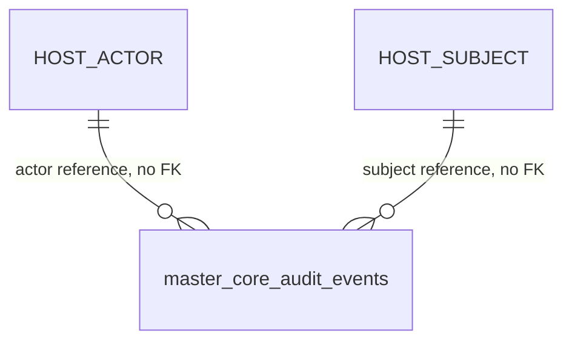

# Phase 7 Proposal: Audit Logs

> **Status: IMPLEMENTED AND VERIFIED WITH CONDITIONS.** Package implementation and isolated verification are complete under the approved decisions in §13. MySQL and authenticated browser acceptance remain deployment conditions. The configured application database has not been migrated.

## 1. Goal and boundaries

Add a separately maintainable Core Audit Logs package that records security-relevant changes across Authentication, User Management, Roles & Permissions, and Settings. Authorized operators can inspect an append-only, server-filtered history through a read-only API and Vue interface.

The package will not replace Laravel application logs, provide general request logging, audit every page view, or create a business-module activity feed. It will not add user/role management, edit or delete audit records, or export records in v1. It will not change Foundation persistence or Laravel stock migrations and models. Host applications may add stricter controls through documented integration points.

## 2. Inspection findings

The repository has a Laravel 12 host, Composer path packages under `packages/core`, and a Vue 3/TypeScript workspace. Foundation owns API conventions and remains database-independent. Core UI supplies shared Vue components. Settings, Authentication, User Management, and Roles & Permissions are separate packages with package-owned persistence where applicable.

The approved database architecture leaves audit storage to a future Audit Logs module. There is no current audit/activity table, persistent audit writer, audit API, or audit UI. `config/logging.php` configures standard Laravel log channels; those are operational logs, not an immutable audit store.

The User Management package emits `UserManagementAction` after commit with an operation and actor/target identifiers. Roles & Permissions emits `RolesPermissionsChanged` after commit with action, subject, and actor identifiers. The Super Admin provisioning path also writes a structured Laravel log entry. These are audit-ready signals, not durable audit records, and they do not carry approved before/after snapshots.

Authentication uses Fortify/Sanctum and Laravel stock user/session/password-reset tables. No current auth-event audit listener was found. Laravel auth events include successful/failed login, lockout, logout, password reset, and verification events; credential-bearing event payloads must never be copied into audit data. Settings persists overrides in `master_core_settings`, applies defaults from code, and invalidates its cache, but has no audit persistence/event listener.

Phase 6 registers executable abilities in code and integrates role grants with Laravel Gates. Its approved security boundary includes `view-audit-logs` as a future registered ability. Role assignment, Super Admin provisioning, and destructive user lifecycle operations have additional safeguards that an audit layer must preserve. The completion report records that isolated SQLite tests passed, while MySQL concurrency and browser acceptance remain deployment checks.

## 3. Recommended architecture

Create `packages/core/audit-logs/` as an optional Laravel package with its own provider, config, package-owned migration, models, recorder, redaction policy, API, tests, docs, and Vue/TypeScript workspace `@master-core/audit-logs`. It depends on Laravel and shared Core UI conventions, not on Foundation database services or a Core User model. It integrates with the host's configured authenticatable model only for server-side actor resolution; the audit table stores actor identifiers without foreign keys.

Use one package-owned table, `master_core_audit_events`, and a synchronous append-only recorder. A versioned Laravel event contract (`master-core.audit.record.v1`) lets producer packages request a record without taking a Composer dependency on Audit Logs. The Audit Logs package validates the contract and writes the record. The relevant producers must emit this signal at the correct transaction boundary; current after-commit events alone are insufficient for an atomic audit trail. If Audit Logs is not installed, existing package behavior remains unchanged.

For critical package mutations (role grants, user lifecycle, and settings changes), the audit insert should use the same connection and transaction as the mutation. The recommended behavior is fail-closed: if a required audit insert fails, roll back the protected change. This prevents an unrecorded security-sensitive change from committing. Auth events that Laravel dispatches after a session or identity operation cannot always share that transaction; v1 should record them synchronously and fail open for authentication availability, writing an emergency diagnostic to the existing Laravel logger if persistence fails. This limitation must be visible in operational documentation and tests.

Do not queue mandatory audit records in v1. Queue delay, retries, and worker failure would separate the record from the transaction. A future proposal may add queued low-risk telemetry, but it must remain distinguishable from mandatory audit events.

## 4. Proposed database schema

### `master_core_audit_events` (single required table)

| Attribute | Proposal |
|---|---|
| Purpose | Append-only record of approved security and administration events. |
| Columns | `id CHAR(26)` ULID; `event_name VARCHAR(120)`; `category VARCHAR(32)`; `outcome VARCHAR(16)`; `source VARCHAR(24)`; nullable `actor_type VARCHAR(191)`, `actor_id VARCHAR(191)`, `subject_type VARCHAR(191)`, `subject_id VARCHAR(191)`; nullable `correlation_id VARCHAR(64)`; nullable `request_method VARCHAR(10)`, `route_name VARCHAR(191)`, `ip_address VARCHAR(45)`, `user_agent VARCHAR(512)`; nullable JSON `before_values`, `after_values`, and `metadata`; `occurred_at TIMESTAMP` UTC; `created_at TIMESTAMP` UTC. |
| Primary key | `id`. Generate ULIDs in application code for portable SQLite/MySQL behavior. |
| Foreign keys | None. Actor and subject may be polymorphic host records that can later be deleted or use different key types. |
| Unique constraints | Primary key only. Event names are code-defined identifiers and not globally unique per row. |
| Indexes | `(occurred_at, id)` for descending timeline pagination; `(category, occurred_at)`; `(event_name, occurred_at)`; `(actor_type, actor_id, occurred_at)`; `(subject_type, subject_id, occurred_at)`; and `correlation_id`. Confirm compound index sizes on supported MySQL versions. |
| Nullable fields | Actor/subject, request context, correlation ID, before/after snapshots, and metadata are nullable. Guest auth failures and console/system events may have no actor or HTTP context. |
| Timestamps | `occurred_at` is the source event time; `created_at` is the persistence time. Store both in UTC. No `updated_at`. |
| Soft-delete policy | No soft deletes. No ordinary application update/delete path. Retention cleanup, if later approved, is an offline privileged archival/purge operation governed by host policy. |
| Relationship behavior | Actor and subject are descriptive polymorphic references without database constraints. Deleting a host user or business record never cascades into audit history. Role/permission labels are captured only as safe event metadata when useful; the record does not depend on live joins. |

`before_values`, `after_values`, and `metadata` contain only allowlisted, normalized values with strict size limits. They must not store passwords, password hashes, reset/verification tokens, API secrets, cookies, session identifiers, CSRF tokens, authorization headers, submitted credentials, full request bodies, or arbitrary model serialization. Settings values are included only when their keys and value types are explicitly declared safe; otherwise record changed key names and a redacted marker.

### Mermaid relationship view



The host references are conceptual only. The package creates no host-user, role, settings, or business-table foreign key.

### Migration and rollback

The single package-owned migration creates the audit table. No Laravel stock, Settings, User Management, or Roles & Permissions migration is altered. Package tests use isolated SQLite `:memory:`; migration deployment is a separately reviewed host operation. A rollback that would drop a populated audit table destroys history and must not be part of routine rollback. Recommend a guarded `down()` that refuses to drop a non-empty table; operators must use a separately approved, verified archival procedure before any destructive rollback.

## 5. Event catalog and producer coverage

Names are stable, lower-case, namespaced identifiers. The actor is resolved from the authenticated host model or console context by server code, never from request input. Outcomes use a fixed vocabulary such as `succeeded`, `failed`, and `denied`; source uses `http`, `console`, or `system`.

| Area | Required v1 events | Safe event detail |
|---|---|---|
| Authentication | `auth.login.succeeded`, `auth.login.failed`, `auth.lockout`, `auth.logout`, `auth.password_reset.completed`, `auth.email_verified`, and security-relevant session revocation. | Outcome, route/context, actor where known. Never include Laravel auth event credentials. Omit the failed-login identifier in v1; do not store a raw identifier or keyed fingerprint. |
| User Management | User create/update, activate/deactivate, trash/restore/permanent deletion, administrative password-reset initiation, and verification resend. | Target ID/type, operation, changed field names and only specifically approved non-sensitive before/after values. Never include password/reset link/token. |
| Roles & Permissions | Role create/update/delete, role-permission grants/revokes, user-role assignment/removal, permission catalog materialization/metadata changes, Super Admin provision/removal, and protected-operation denials. | Immutable role key/registered ability IDs, target identifier, grant delta, actor and outcome. Never treat audit recording as a substitute for current last-admin and grant-scope checks. |
| Settings | Settings group update/reset and branding asset changes. | Changed setting keys and safe normalized values or redaction markers. Secret-like settings remain prohibited by Phase 3 standards. |

Do not automatically record every validation error, read, API request, or generic application log. Failed login and explicit security-denial events are in scope; ordinary failed CRUD validation is not. Password confirmation has no native Laravel event in the inspected setup; instrument only if the host identifies a concrete security requirement and approves the event source.

## 6. Integration and transaction rules

- **Contract:** a versioned, documented event envelope with required `event_name`, `category`, `outcome`, `source`, `occurred_at`, and allowlisted optional actor/subject/context/change fields. The audit listener rejects unknown fields, invalid identifiers, unsupported names, oversized payloads, and sensitive keys. No request payload passthrough.
- **Producer ownership:** each domain package decides when an operation actually succeeds and supplies a safe change summary. The audit package owns validation, redaction enforcement, persistence, query policy, and presentation. Existing Phase 5/6 after-commit domain events remain useful to other listeners but are not the mandatory transactional audit signal.
- **Transactions:** mandatory mutation records are inserted before commit on the same DB connection. Add tests proving the business mutation rolls back when the audit insert fails and both commit together when it succeeds. Never emit a success record before the mutation is known to be valid.
- **Failure events:** for a denied or failed security attempt where no business transaction is committed, write the event independently without storing rejected payload data. If audit storage is unavailable, follow the approved failure policy and emit a sanitized diagnostic to the Laravel operational logger.
- **Authentication:** listen to the relevant Laravel/Fortify lifecycle events and map them to safe records. The listener must explicitly discard credential-bearing payload members. These events often happen outside a single transaction containing the session state, so they cannot promise the same atomicity as domain mutations.
- **Correlation:** generate a server-side request correlation ID and propagate it through the request and audit event; accept an incoming ID only after strict length/character validation and preferably replace untrusted IDs with a server-generated value. Do not capture URL query strings, request bodies, cookies, or headers other than a validated correlation header.
- **Optional package:** producers continue working when Audit Logs is absent. The versioned event is a no-op without a listener. Host integration tests must verify the listener is registered exactly once when the package is installed.

## 7. API and Vue interface

Register `view-audit-logs` in the Phase 6 code permission registry. Do not auto-grant it. All private routes require `auth:sanctum` and server-side `can:view-audit-logs`; UI visibility is not authorization. The permission management API cannot create arbitrary abilities, consistent with Phase 6.

| Method and path (default `/api/v1`) | Purpose | Permission |
|---|---|---|
| `GET /audit-logs` | Read paginated, server-filtered event summaries. | `view-audit-logs` |
| `GET /audit-logs/{event}` | Read one event's allowlisted detail and safe change diff. | `view-audit-logs` |

Filters are validated allowlists: date range, event name, category, outcome, actor/subject identifier, and correlation ID. Search must not scan raw JSON values. Sorting is limited to indexed columns (initially `occurred_at`); pagination is server-side with shared standards (10/25/50/100 per page and no more than five page links). Enforce a bounded date range and maximum page size. Do not permit client-defined SQL columns, arbitrary JSON paths, or unbounded result sets.

The Vue screen is read-only and composes into the existing authenticated shell using Core UI/DataTable components. It shows timestamp in the user's configured locale while the API returns UTC ISO-8601; event/category/outcome; safe actor and subject identifiers; a concise change summary; and correlation ID. The detail view renders escaped, allowlisted diff data. It includes loading, empty, validation, network, and 403 states and a responsive accessible layout. It has no create/edit/delete/restore/bulk actions. Navigation visibility checks `view-audit-logs`; direct route access still calls the protected API and receives 403 when unauthorized. No export control is shown in v1.

CSV/JSON export is **OUT OF SCOPE for v1**. Register `export-audit-logs` in the Phase 6 code permission registry so it is a known, non-granted ability, but add no export endpoint, job, UI action, or data path in this phase. Registration does not implement export or grant access.

## 8. Security, privacy, retention

- Apply a deny-by-default read policy and use registered Laravel Gate abilities. Keep host contextual policies available; do not infer audit access from `manage-settings`, `manage-users`, or role-management abilities.
- Resolve actor identity server-side. Store opaque type and ID only; do not snapshot email/name by default. Collect IP address and User-Agent by default as approved. Make each field configurable so a host can disable collection when its privacy policy requires it; apply field-specific validation, sanitize and cap User-Agent at the schema limit, and never trust forwarded IP headers unless the host has configured trusted proxies. Document purpose, access, and configurable retention for both fields.
- Use field-level allowlists and defense-in-depth redaction. Add tests with sentinel secrets to prove they do not appear in persisted JSON or API output. Do not serialize Eloquent models or arbitrary exception/request objects.
- Append-only application APIs and absent update/delete endpoints reduce tampering risk but do not make the database cryptographically immutable. Production deployment must restrict the application DB principal to the privileges needed to read and insert audit rows, with no update/delete permission; use a separate migration/maintenance principal where the deployment supports it. A privileged database administrator can still alter records, indexes, or privileges; this limitation must be documented. A DB trigger is not the default because SQLite/MySQL behavior differs, and it is not required when the approved privilege restrictions are enforced.
- Retention is configurable and documented in v1 through a host setting such as `retention.period_days`; `null` means retain indefinitely. `retention.purge_enabled` defaults to `false`. No destructive purge runs by default. Purge may be enabled only after the host has approved and configured a retention policy; any purge must be offline or separately privileged, auditable, count- and backup-verified, and unavailable through the ordinary web API. IP/User-Agent values are retained for the lifetime of their audit row; collection can be disabled, but individual fields are not later erased because audit rows are append-only.
- Audit access and export can itself expose sensitive operational history. Consider logging successful audit-log reads at the Laravel operational level; a self-audit event can be a later approved feature to avoid recursive write volume.
- Critical Settings/User Management/RBAC mutations fail closed: if the required audit insert fails, the corresponding business transaction rolls back. Authentication event audit failures fail open so they never block login, logout, or password-reset flows; report a sanitized diagnostic through operational logging without credentials, tokens, or request secrets. Monitor these failures.

## 9. Test strategy

All default automated database tests use isolated SQLite `:memory:`; never point test configuration at the host application database. Add an isolated MySQL integration suite before production deployment for JSON behavior, collation/index sizes, transaction semantics, and privileges.

- Schema tests: migration creates only the proposed table, key/index/nullability/timestamp behavior, ULID generation, UTC serialization, and SQLite/MySQL-compatible query shapes.
- Recorder tests: valid and invalid event envelopes; unknown fields; payload limits; safe before/after values; redaction of passwords, tokens, cookies, headers, and model serialization sentinels; guest, console, and deleted actor/subject references.
- Integrity tests: domain mutation and audit insert commit/rollback together; failed mandatory insert rolls back critical change; auth logging failure follows the approved fail-open policy and emits a sanitized operational diagnostic.
- Integration tests: login success/failure/lockout/logout/password reset/verification; user lifecycle; role and Super Admin operations; Settings changes and reset; no duplicate listener; optional package behavior when audit package is absent.
- API tests: unauthenticated 401, unauthorized 403, registered ability enforcement, filter/sort/page allowlists, bounded date range, no secret fields in summaries/details, and no write routes.
- UI tests: visible route for authorized users, forbidden state on API 403, loading/empty/error states, filters/pagination, safe diff rendering, and no mutation controls. Run TypeScript checks and production build.
- Operational acceptance: verify backup/restore, DB least privilege, retention decision, package migration plan, monitoring for audit insert failures, and host-specific Gate behavior. MySQL concurrency checks remain separate from SQLite assertions.

## 10. Dependencies and package layout

No third-party runtime dependency is recommended. Reuse Laravel's event dispatcher, database, auth, validation, Gates, and the existing Vue/Core UI packages. Do not add a Core User model, modify Laravel stock migrations, or make Foundation depend on audit persistence.

```text
packages/core/audit-logs/
├── composer.json
├── package.json
├── README.md
├── config/audit-logs.php
├── database/migrations/                 # one package-owned audit table
├── routes/api.php
├── src/
│   ├── Events/                           # versioned event contract/listener boundary
│   ├── Http/Controllers/Requests/Resources/
│   ├── Models/AuditEvent.php
│   ├── Policies/AuditEventPolicy.php
│   ├── Providers/AuditLogsServiceProvider.php
│   └── Support/                          # recorder, redaction, context, filters
├── resources/js/
│   ├── api.ts
│   ├── routes.ts
│   ├── components/
│   └── pages/AuditLogsPage.vue
├── tests/Feature/
└── tests/Unit/
```

Root Composer/npm workspace, auth router composition, Phase 6 ability registry, and explicit event producers in Settings/Auth/User Management/Roles & Permissions are approved integration points only after this proposal is approved. Their existing ownership and Phase 3–6 behavior must remain intact.

## 11. Implementation sequence after approval

1. Confirm the decisions below and reconfirm target DB/deployment restrictions.
2. Add the package manifests/config/provider and isolated schema tests; do not run the host application's migrations.
3. Implement event-envelope validation, synchronous recorder, redaction, UTC/context policy, and append-only model boundary.
4. Integrate critical mutation producers with same-transaction recording and auth lifecycle events with the documented availability policy.
5. Register `view-audit-logs` in the Phase 6 code registry and add read-only authorized API filters/resources.
6. Add the read-only Vue page using Core UI, compose the route into the existing shell, and add page/API denial tests.
7. Document installation, producer event contract, privacy, retention, transaction failure behavior, DB privileges, and host authorization.
8. Run targeted PHP/UI tests, full regressions, TypeScript, build, and isolated MySQL integration where available. Report browser and deployment acceptance separately. Never migrate the configured application database without explicit separate approval.

## 12. Risks and compatibility concerns

- Existing after-commit Phase 5/6 events cannot guarantee that every committed change has an audit row; producer instrumentation at transaction time is required.
- Fail-closed audit writes improve integrity but reduce availability if the audit table is unavailable. Fail-open authentication logs can have gaps. Monitoring and host-approved behavior are required.
- IP, user-agent, actor IDs, and snapshots can be sensitive or regulated personal data. Collection and retention need host/legal review.
- An append-only application API does not protect against a privileged database administrator. Least-privilege DB grants improve tamper resistance but need deployment validation.
- JSON, index-size, timestamp, collation, and database privilege differences need actual MySQL verification; SQLite tests cannot prove them.
- Authentication events may not share a transaction with session changes, so the proposal does not claim atomic audit capture for those events.
- Shared event names are a cross-package contract. Versioning, payload validation, and duplicate-listener tests are required to avoid drift.
- Audit table growth may be high for failed login events. Index and retention policy must be decided before production, with no unbounded JSON search.

## 13. Approval checklist

These decisions are approved for Phase 7 implementation, subject to the conditions stated below.

1. **Schema:** approved: one `master_core_audit_events` table with ULID and no host foreign keys.
2. **Event coverage:** approved: the mandatory Authentication, User Management, Roles & Permissions, and Settings events in §5; password-confirmation and ordinary validation failures remain out of v1.
3. **Transaction/failure policy:** approved: fail closed and roll back critical mutations when required audit persistence fails; fail open for authentication event recording failures and report sanitized operational diagnostics.
4. **Event integration:** approved: versioned Laravel event envelope and synchronous listener, with critical producer signals emitted in their owning transaction; preserve existing after-commit domain events.
5. **Sensitive data:** approved: strict field allowlists; no arbitrary snapshots or failed-login identifier/fingerprint. Collect IP and User-Agent by default with privacy controls, size limits, configurable retention for their audit rows, and host opt-out controls.
6. **Immutability:** approved: no ordinary update/delete API or soft delete; restrict the production application DB principal from updating/deleting audit rows. Document that privileged database administrators remain capable of tampering.
7. **Retention:** approved: provide and document configurable retention in v1. Do not perform destructive purge unless the host has approved and configured a retention policy.
8. **Read API/UI:** approved: authenticated, `view-audit-logs`-only read access. Export remains out of scope for v1.
9. **Permissions:** approved: register both `view-audit-logs` and `export-audit-logs` in the Phase 6 code registry without automatic grants. Registration of the export ability does not add export functionality.
10. **Correlation/privacy details:** approved: server-generated correlation IDs and UTC storage; do not retain a failed-login identifier fingerprint in v1.
11. **Database acceptance:** approved: SQLite in-memory automated tests and isolated MySQL schema/transaction/privilege verification before deployment. No configured application database migration is included in this plan.

## 14. Acceptance criteria

- Audit Logs is separately maintainable and optional; Foundation and existing stock models/migrations remain unchanged.
- Only the single approved package-owned table is introduced; it has no host-user/business FKs and no soft-delete/update path.
- Required producer events are recorded with actor resolution, safe event names, UTC timestamps, correlation context, and allowlisted values.
- Sensitive credentials, tokens, session/CSRF data, and arbitrary request/model payloads never persist or appear in API responses.
- Critical mutation audit writes are atomic under the approved transaction policy; auth event limitations and failures are documented and observable.
- API and UI are read-only, server-authorized, paginated/filtered, and return 403 for unauthorized users.
- Permission catalog and grant scope remain governed by Phase 6; no automatic permission assignment occurs.
- Isolated SQLite tests, frontend tests, type checks, and production build pass; deployment MySQL, DB privilege, retention, and browser acceptance are reported separately.

## 15. Approved conditions before deployment

The Phase 7 architecture and checklist are approved with the conditions above. Implementation must retain the critical-mutation rollback behavior, authentication fail-open behavior, privacy controls, permission registry entries, configurable retention, append-only API, and database privilege restrictions. Before production deployment, configure and document the host retention period/purge policy, verify database principals and backups, and complete isolated MySQL and browser acceptance. No configured application database migration is authorized by this proposal.
